# System architecture: database schema

Part of [System architecture](system-architecture.md).

## 7. Library database schema

drift, `schemaVersion = 12`, file `library.db`. Times are epoch milliseconds. Browse queries are raw SQL (`customSelect`) that read `tracks`; there are no `albums` or `artists` tables. Albums and artists are `GROUP BY` over the text keys. Schema 5 adds the user-data tables `plays`, `play_stats`, `playlists` and `playlist_entries`: data a scan cannot rebuild (see [User data](system-architecture-user-data.md#user-data)). Schema 6 adds `cover_colors` (colors extracted from cover thumbnails, rebuildable), `excluded_folders` (folders the scan skips, user configuration) and `playlists.kind` (see [Playlist kinds](system-architecture-user-data.md#playlist-kinds)). Schema 7 adds `tracks.language`, the language tag as written (ID3 `TLAN`, Vorbis/FLAC/Opus `LANGUAGE`, MP4 freeform `LANGUAGE`, APE `Language`, RIFF `ILNG`), trimmed, empty as NULL, at most 128 bytes; `language_tags.dart` splits and normalizes it when read. Language reads live in `language_queries.dart`: `languageCounts` groups the stored strings, `buildLanguageSummaries` splits and normalizes them (`language_tags.dart`) into one entry per language key, and the page queries take the stored strings of that key as one JSON array read with `json_each` (no variable limit). Schema 8 adds `lyric_translations` (one row per lyrics hash, provider and target language; `lines_json` maps source line to translation) and `lyric_translation_prefs` (target language chosen per song). Both are keyed by `lyricsContentHash` with no foreign key to `tracks`, survive rescans and `make reset-library`, and `lyric_translations` is emptied only by "Clear saved translations"; `lyric_translation_prefs` is kept. The invariants are in `lyric_translation_tables.dart`; queries in `lyric_translation_queries.dart`; `core/lyrics_translation/translation_cache.dart` decodes rows (a corrupt row reads as missing). Rollback: a dev database at v8 cannot be opened by a v7 build; recover with `sqlite3 library.db "DROP TABLE lyric_translations; DROP TABLE lyric_translation_prefs; PRAGMA user_version=7;"`. Schema 9 adds `online_lyrics` (one row per metadata cache key and provider: `status` `found` or `not_found`, `remote_id`, synced and plain text, `instrumental`, remote duration, `fetched_at`), `lyrics_pins` (one row per song, keyed by local path else uri: the picked lyrics with their own text; schema 9 also stored a skip as a row with no pick, which schema 10 removes) and `online_lyrics_rejects` (matches the user marked "Not these lyrics", per cache key, provider and remote id). No foreign key to `tracks`; all three survive rescans and `make reset-library`. A `found` row never expires; a `not_found` row older than the miss TTL is a miss. There is no CHECK constraint: readers skip unknown `status` or provider values. "Clear online lyrics" empties all three tables and never touches `.lrc` files. Schema 10 adds `lyrics_pins.mode` (the song's choice: `local`, `online` or `off`; null = auto) and `online_lyrics_rejects.content_hash` (the `lyricsContentHash` of the rejected text; null for rejects made before schema 10). The migration (`library_migration_v10.dart`) runs in one transaction and can run again on a half-migrated file: it adds each missing column, sets `mode` to `online` on pins with a pick, and deletes the pins left with no mode and no pick (the old skips, so the song goes back to auto). Old rejects keep a null hash and match by id only.

Invariants (`online_lyrics_tables.dart`):

- A rejected match is never stored as found for its key again, and neither is a record whose text hash equals a rejected `content_hash`; lookups drop both before ranking.
- `remote_id` NULL means no pick is stored. A `local` or `off` choice may have no pick.
- `mode` `online` implies a pick is present. A null or unknown `mode` (from a newer build) reads as auto and the row is kept.
- Resolving which lyrics to show never writes; only user actions and lookups do.

Queries: `online_lyrics_queries.dart` (cache rows, stats, clear) and `lyrics_choice_queries.dart` (choice, pick, reject, stored text). Stats (`watchOnlineLyricsStats`) are `found`, `notFound`, `picks` (pins with a pick), `choices` (`local` or `off` pins without a pick), `rejects` and `bytes`; there is no skip count.

Rollback from v12: no SQL step. A v11 or older build cannot open a v12 file (drift refuses to downgrade), so a dev database is recreated.

`tracks.extra_tags` (schema 12): nullable JSON text with tag values the library does not index, read for one track only (the song details dialog). Format and codec live in `extra_tags.dart`: an object with a `"v"` key (`extraTagsVersion`, currently `1`) and `"releaseDate"`, the raw date as the tag wrote it (`2019`, `2019-07-15`, `20190715`; Rust picks the first usable of recording date, release date, year, original release date; an empty or over-64-byte value is skipped for the next key. It matches `year` only when a recording date is present). Absent keys are omitted, so a file without a date stores `{"v":1}`; NULL means "not read yet". `decodeExtraTags` ignores invalid JSON, wrong types and unknown keys; the encoder drops a key that would pass 4 KB. A row is flagged for a re-read when `extra_tags` is NULL or its `v` is below `extraTagsVersion` and it has no `scan_error` (`TrackSnapshot.needsExtraTags`). Adding a key means bumping `extraTagsVersion`: every row is read once more, no schema change. The scan writes the column with the row on insert and update (NULL when the read failed); an unchanged file that only needs it is read again and gets `UPDATE tracks SET extra_tags = ? WHERE id = ? AND mtime_ms = ? AND size_bytes = ?` (`updateExtraTags`, chunked), which leaves `updated_at`, the cover columns and the keys alone. List queries never select the column; only `watchTrackDetails` (`track_details_queries.dart`) does. The v11 → v12 step (`library_migration_v12.dart`) adds the column in one transaction when `PRAGMA table_info(tracks)` lacks it, so it can run again.

Lyrics plugin tables (schema 11; `lyrics_plugin_tables.dart`, queries in `lyrics_plugin_queries.dart`, `lyrics_plugin_data_queries.dart`, `lyrics_source_pref_queries.dart`, `lyrics_plugin_repo_queries.dart`):

| Table | Holds |
|---|---|
| `lyrics_plugins` | One record per installed plugin: `install_id` (the source id, `plugin-...`), name, author, description, `version`, `api_version`, `hosts` and `config_schema` (JSON text), `package_dir` (relative directory of the current package), install source (`source_kind` `file` or `repo`, `source_name`, `repo_url`, `repo_slug`), `installed_at`, `updated_at`, `removed_at`. Partial unique index on `(repo_url, repo_slug)` where `repo_url IS NOT NULL`. The source list watches it. |
| `lyrics_source_prefs` | `provider_id`, `enabled`, `position` for LRCLIB and plugins. No `lrclib` row means enabled, position 0. |
| `lyrics_plugin_repos` | Repositories the user added: `url`, name, author, `added_at`, `last_fetched_at` (last success), `last_error` (kind string), `catalog` (last good catalog JSON, at most 1 MiB). |
| `lyrics_plugin_data` | One row per live plugin: `config_values` (non-secret) and `storage` (localStorage), JSON objects, each at most 64 KiB. Not watched by the source list, so a config or storage write never rebuilds the lyrics streams. |

Invariants:

- `provider_id` in `online_lyrics`, `lyrics_pins`, `online_lyrics_rejects` and `lyrics_source_prefs` is `lrclib` or a `lyrics_plugins.install_id`, installed or removed; readers skip other values.
- `removed_at` set means the plugin is gone but saved lyrics, a pin or a reject still name its id. Uninstall (`uninstallLyricsPlugin`) is one transaction: it deletes the plugin's `not_found` rows, data row and preference row, then deletes the record when no found row, pin or reject names it, else marks it removed; it returns which happened and the old `config_schema` (for deleting secrets). Uninstalling a removed record changes nothing and returns no schema. A removed record is hard-deleted at uninstall, by `clearLyricsPluginSavedLyrics` once nothing names it, and by "Clear online lyrics"; removing the last pin or reject elsewhere does not delete it. A revive keeps the id, starts config, storage and preference empty, and moves `updated_at` forward.
- Source preferences (`setLyricsSourceEnabled`, `reorderLyricsSources`) are written for a plugin id only while its record exists and is not removed (else `skipped`); `lrclib` is always allowed. A reorder puts the given ids first and keeps every other source after them in its current order, `lrclib` (no row) included, so positions are 0..n with no tie.
- A plugin's `online_lyrics` row is saved only while its record exists and is not removed (`saveOnlineLyrics` returns whether it wrote), so a lookup that outlived an uninstall leaves no orphan row. LRCLIB rows are unchanged.
- `updated_at` changes on install, revive and package switch. `setLyricsPluginStorage` writes only while the record is live and `updated_at` equals the value the run began with; it returns `written`, `skipped` or `tooLarge`.
- A package switch (`switchLyricsPluginPackage`) changes `package_dir`, version, hosts, schema and `updated_at` in one statement and keeps config, storage and preferences. `lyricsPluginPackageDirs` lists the live records' directories for the startup sweep.
- "Clear" for one source (`clearLyricsPluginSavedLyrics`) deletes only that source's `online_lyrics` rows; pins and rejects stay.

```mermaid
erDiagram
    LIBRARY_ROOTS {
        int id PK
        text path UK "canonical, unique"
        int added_at
        int last_scan_at
    }
    TRACKS {
        int id PK
        int root_id FK "cascade delete"
        text path UK "natural key"
        int mtime_ms
        int size_bytes
        text title "not null"
        text artist "multi-value, joined with semicolon"
        text album
        text album_artist
        int track_no
        int disc_no
        int year
        text genre
        text language "raw tag, trimmed, at most 128 bytes"
        int duration_ms
        int bitrate
        int sample_rate
        int added_at "stable across rescans"
        int updated_at
        text scan_error
        text cover_key
        int cover_scan_version
        text album_artist_key
        text album_title_key
        text title_sort
        text artist_sort
        text album_sort
        int keys_version
        text artist_search "folded tag, null without the tag"
        text album_search "folded tag, null without the tag"
        text album_artist_search "folded tag, null without the tag"
        text genre_search "folded tag, null without the tag"
    }
    TRACK_SEARCH {
        text title_sort "FTS5 external content, rowid = tracks.id"
        text artist_search
        text album_search
        text album_artist_search
        text genre_search
    }
    TRACK_ARTISTS {
        text artist_key PK
        int track_id PK "cascade delete"
        text artist_name
    }
    PLAYS {
        int id PK
        text path "= tracks.path, no FK"
        int played_at "start of the play"
        int listened_ms "null = unknown"
    }
    PLAY_STATS {
        text path PK "= plays.path, no FK"
        int play_count
        int first_played_at
        int last_played_at
    }
    PLAYLISTS {
        int id PK
        text name "not unique"
        int created_at
        text kind "null = ordinary, favorites = at most one row"
    }
    PLAYLIST_ENTRIES {
        int id PK
        int playlist_id FK "cascade delete"
        text path "= tracks.path, no FK"
        int position "dense 0..n-1, not unique"
    }
    COVER_COLORS {
        text cover_key PK "= tracks.cover_key, no FK"
        int seed "ARGB, 0 = no usable accent"
        text palette "ARGB hex, comma-separated"
        int algo_version
    }
    EXCLUDED_FOLDERS {
        int id PK
        text path UK "canonical, no FK to roots"
        int added_at
    }
    LYRIC_TRANSLATIONS {
        text content_hash PK
        text provider PK "google or deepl"
        text target_lang PK
        text source_lang
        text lines_json "source line to translation"
        int created_at
    }
    LYRIC_TRANSLATION_PREFS {
        text content_hash PK
        text target_lang
    }
    ONLINE_LYRICS {
        text cache_key PK
        text provider_id PK
        text status "found or not_found"
        text remote_id "NULL when not_found"
        text synced_text
        text plain_text
        bool instrumental
        int remote_duration_ms
        int fetched_at
    }
    LYRICS_PINS {
        text track_key PK "local path, else uri"
        text mode "local, online or off; NULL = auto"
        text provider_id "NULL when no pick"
        text remote_id "NULL when no pick"
        text synced_text
        text plain_text
        bool instrumental
        int remote_duration_ms
        int pinned_at
    }
    ONLINE_LYRICS_REJECTS {
        text cache_key PK
        text provider_id PK
        text remote_id PK
        text content_hash "NULL for older rejects"
    }
    LYRICS_PLUGINS {
        text install_id PK "plugin-..., the provider_id"
        text name
        int version
        text package_dir
        text repo_url "NULL for file installs"
        text repo_slug
        int updated_at
        int removed_at "set = removed, kept for saved lyrics"
    }
    LYRICS_SOURCE_PREFS {
        text provider_id PK "lrclib or install_id"
        bool enabled
        int position
    }
    LYRICS_PLUGIN_REPOS {
        text url PK
        text name
        int last_fetched_at
        text last_error
        text catalog "last good, JSON"
    }
    LYRICS_PLUGIN_DATA {
        text install_id PK
        text config_values "JSON, non-secret"
        text storage "JSON localStorage"
    }
    LYRICS_PLUGINS ||--o| LYRICS_PLUGIN_DATA : "install_id"
    LYRICS_PLUGINS |o..o{ ONLINE_LYRICS : "provider_id"
    LIBRARY_ROOTS ||--o{ TRACKS : "root_id"
    TRACKS ||--o{ TRACK_ARTISTS : "track_id"
    TRACKS ||--|| TRACK_SEARCH : "indexed, kept by triggers"
    TRACKS |o..o{ PLAYS : "matched by path"
    PLAYS }o--|| PLAY_STATS : "kept by triggers"
    PLAYLISTS ||--o{ PLAYLIST_ENTRIES : "playlist_id"
    TRACKS |o..o{ PLAYLIST_ENTRIES : "matched by path"
    TRACKS }o..o| COVER_COLORS : "matched by cover_key"
```

Only the main columns are shown; the library tables are in `lib/core/database/library_tables.dart` and the user-data tables in `lib/core/database/user_data_tables.dart`.

Indexes: `tracks_root(root_id)`, `tracks_title_sort(title_sort, id)`, `tracks_album_key(album_artist_key, album_title_key)`, `tracks_keys_version(keys_version)`, `tracks_language(language)`, `tracks_added_at(added_at)`, `track_artists_track(track_id)`, `plays_path_played(path, played_at)`, `plays_played_at(played_at, path)` (covers date-range aggregates), `playlist_entries_order(playlist_id, position)`, `playlists_favorites_unique` (partial unique: `ON playlists (kind) WHERE kind = 'favorites'`). Full-text index: `track_search`, a virtual table (see [Full-text search](#full-text-search)). Triggers on `plays` in `listen_history.drift`: `plays_stats_insert`, `plays_stats_delete`, `plays_stats_update`; they are the only writers of `play_stats`.

Writes and reads:

| Topic | Behavior |
|---|---|
| Upsert | Batched `INSERT ... ON CONFLICT(path) DO UPDATE`; keeps `id`, `root_id`, `added_at`. Keys are computed by `trackKeysFor`. `track_artists` is replaced in the same transaction. |
| Deletes | Chunked, 500 ids per statement. |
| Whole-library lists | `throttledTracksQuery` replaces drift `.watch()`, because `.watch()` restarts on every write and starves during scans. Dirty flag, no overlapping loads, cooldown. |
| Songs paging | IDs come from `group_concat`; pages of 200; `songsByIds` in chunks of 200 keeps order; `songQueueFrom(trackId)` reads in one transaction. |
| Genres | No table. `genreCounts()` is one `GROUP BY genre`; Dart splits each stored string on `;` (`splitGenres`, separators are a parameter) and merges spellings by `sortKey` (`buildGenreSummaries`). A genre page reads its tracks and albums with `genre IN (…)` over the stored strings of that key. The scanner stores only the first genre of a file. |
| Folders | No table, no disk walk. `folderSongCounts()` reads `tracks.path` in pages of 5 000 ordered by the unique index (keyset, `path > last`) and takes the directory of each path in Dart (SQL `GROUP BY rtrim(path, replace(path, '/', ''))` held the database isolate for seconds on 100k tracks); `buildFolderTree` turns the counts and `library_roots` into a tree with recursive counts, on another isolate above 2 000 folders, reloaded at 5 times the browse interval. A subtree is the BINARY range `path >= 'X/' AND path < 'X0'` (`0` follows `/`), read by `folderTracks` (SQL order) and put in tree order in the feature (`readFolderSongs`: relative path split at `/`, each part by `naturalKey`, computed once per path; above 5 000 paths on another isolate). |
| Ordering | Songs: NULLs last in both directions, ties by `title_sort`, `id`. Albums and artists are sorted in Dart by code point, matching the database. |
| Text keys | Pure Dart (`text_keys.dart`, generated tables in `text_key_tables.dart`). `textKeysVersion = 3` (version 2 added the search columns, version 3 the new default artist separators). `keys_version` also depends on the artist split rules and the album grouping (see "Album keys"): `keysVersionFor(rules, grouping)` is `textKeysVersion` for the default rules and grouping and `textKeysVersion + 1 + (fnv1a32(canonical rules) mod 2^30)` for any other (rules that behave the same share a version; a collision, odds 2^-30, only skips one re-key). Stale means a version *different from* the current one (`keys_version < v OR keys_version > v`, index `tracks_keys_version`), not older, so changing the rules, or changing them back, re-keys every row. Stale rows are re-keyed in place when few (≤ 500), or in a background isolate. Conditional writes let a concurrent scan win, but they no longer stop an older rule set from overwriting a newer one: `LibraryKeys` listens to the rules and the album grouping, runs again when the rules or grouping at the end of a run differ from the ones it used (and once more when a scan finished during the run), and shows the same "Updating library" progress as the first run. `track_artists` rows are read in `rowid` order for a song's artist links, so those follow whatever rules keyed the track. Genres are split when read (`genreSplitRulesProvider`), so changing the genre rules needs no re-key. |
| Migrations | Step-by-step (`library_database.steps.dart`). v1 → v2 adds cover columns; v2 → v3 is schema-only and re-runnable (`library_migration_v3.dart`). v3 → v4 adds the four search columns, creates `track_search` and its triggers, and runs one index `rebuild` (`library_migration_v4.dart`). Values are filled by the background key backfill. v4 → v5 creates the four user-data tables, their indexes and the `play_stats` triggers in one transaction; `plays` starts empty, so there is no backfill (`library_migration_v5.dart`, re-runnable). v5 → v6 creates `cover_colors` and `excluded_folders`, adds `playlists.kind` (NULL for existing playlists) and the partial index, in one transaction, no backfill (`library_migration_v6.dart`, re-runnable). v6 → v7 adds `tracks.language` and the indexes `tracks_language` and `tracks_added_at` in one transaction, and sets every `mtime_ms` to -1 so the next scan reads the tags again and fills `language` (`added_at`, plays and playlists are kept; fine because the schema is unreleased and only development databases are at v6; `library_migration_v7.dart`, re-runnable). v7 → v8 creates the two translation tables and v8 → v9 creates the three online lyrics tables (`library_migration_v8.dart`, `library_migration_v9.dart`); both start empty with no backfill. v9 → v10 adds `lyrics_pins.mode` and `online_lyrics_rejects.content_hash` and sets `mode` to `online` on pins with a pick (`library_migration_v10.dart`, re-runnable; no hash backfill). v10 → v11 creates the four lyrics plugin tables and the unique index `lyrics_plugins_repo_unique`, each only when missing (`library_migration_v11.dart`, re-runnable). v11 → v12 adds `tracks.extra_tags` when missing (`library_migration_v12.dart`, re-runnable); existing rows stay NULL and the next scan fills them without a rescan of covers. |
| Album keys | `album_artist_key` and `album_title_key` follow the album grouping (`AlbumGrouping`, settings). The title is always in the key. With `byAlbumArtist` (default) the artist part is the album artist's key; without it the artist part is empty, so one title is one album across artists and the album shows one artist name. With `byYear` the title part is `titleKey` + U+001F + year (`albumYearKeySeparator`; U+001F never occurs in a `groupKey`); tracks without a year get no year part, so they group apart from dated ones. `keysVersionFor(rules, grouping)` keeps `textKeysVersion` for the default rules and default grouping (existing databases are not re-keyed); any other combination hashes into the version, so a grouping change re-keys every row in the background like a rule change. `upsertTracks` has no grouping parameter: it reads a per-database registry (`albumGroupingFor(db)`, an `Expando` on the `LibraryDatabase`), which `LibraryKeys` sets (`useAlbumGrouping`) from `albumGroupingProvider` before any scan and on every change. The backfill isolate opens its own database with no registry entry, so it gets the grouping explicitly. |
| Full-text index | External-content FTS5 table `track_search` over `title_sort`, `artist_search`, `album_search`, `album_artist_search`, `genre_search`; `unicode61 remove_diacritics 0`, prefixes 1 to 3. The three triggers in `library_search.drift` are its only writers; Dart never writes it. They fire on insert, on delete (including a root cascade), and on update of an indexed column whose value changed. `recursive_triggers` is on, so `REPLACE` deletes fire too. |
| Search query | `searchTerms` splits the query into words folded like the columns; each becomes `"word"*` and all are required. Songs: `bm25` with weights 20, 2, 1.5, 1, 0.5 in column order, then `title_sort`, `id` (weighted, not strict). One-character single-word queries order by `title_sort`, `id`. `searchSongsFor(SearchRequest)` (SQL built by `search_song_sql.dart`, pure and tested alone) writes the free words as `{cols} : ("w"* …)` over the chosen tag columns (all five columns: no column filter, the plain query above), `artist:`/`album:`/`genre:` words as `artist_search : (…)` etc. whatever the chosen fields, joined with `AND`; `year:` and `format:` are `WHERE` clauses on `tracks` (`year >= ? AND year <= ?`, `lower(path) LIKE '%.flac'`, bound), so a song with no year never matches. `language:` is `language IN (SELECT value FROM json_each(?))`: Dart reads the distinct raw `tracks.language` values (`search_language_values.dart`; cached by `searchLanguagesProvider`, throttled with the library, so typing does not read it), keeps those whose `splitLanguages` has a `languageKey` equal to a wanted one, and binds them; no such tag gives no songs, and a NULL language never matches. With only filters there is no `MATCH`: the scan is ordered by `title_sort`, `id`. File name and comment are not in the FTS index: `SearchFileTextIndex` (built from `id, path, comment` in a background isolate, words folded like the columns, extension and folders left out) returns ids that are bound as a JSON array (`json_each`), scored far after any bm25 score, merged with the tag hits by `min(score)`, and still checked against the field terms and filters. A song matches when every word is in the chosen tag fields, or every word is in its file name or comment, not a mix. One statement returns at most 200 songs and the total match count after the filters. `searchSongs(terms)` is the plain-words wrapper. Albums and artists are filtered in Dart over `albums()` and `artistCredits()` with the same terms (`SearchNameIndex`). A corrupt index is rebuilt once per database and the search retried. |
| Listen history | `plays` is a log: `path` and `played_at` do not change in normal use; only the recorder sets `listened_ms` of the play it is recording, coarsely (pause, stop, track end, reaching the count threshold), not per tick: drift cannot see the trigger's `WHEN` filter, so every `plays` update re-runs all `play_stats` watchers. Stats are kept by triggers, never by Dart. Range aggregates read `plays`. Details in [User data](system-architecture-user-data.md#user-data). |
| Playlists | Dense positions `0..n-1` per playlist, changed only inside one transaction; readers order by `position, id`. Duplicate paths allowed; deleting a playlist cascades to its entries. Details in [User data](system-architecture-user-data.md#user-data). |

### Full-text search

Data flow: the scan and the key backfill write `tracks`, with the folded columns from `trackKeysFor`; the triggers copy them into `track_search`. A search goes top bar → `/search?q=…` → `searchTerms` → `searchSongs` (SQL) and the Dart filters for albums and artists → the search page. Dart issues only `rebuild`, in the migration and in corruption repair.

Query syntax: `parseSearchQuery` (`core/search/search_query_parser.dart`) splits the raw query on spaces outside double quotes (an unclosed quote runs to the end). `artist:`, `album:` and `genre:` (prefix case-insensitive) give per-field terms; `year:` takes `2010`, `>2010`, `<2000`, `>=`, `<=` or `2010-2015` (a reversed range swaps; years 1 to 9999; several `year:` all apply); `format:` takes an extension from `audioExtensions` (several are alternatives); `language:` takes any non-empty value (several are alternatives, kept trimmed as typed and compared by `languageKey`). Anything else, such as an unknown prefix, an empty or invalid value, stays free text. Free and per-field terms together are capped at `maxSearchTerms` (8, last dropped); filters are not capped. Keywords are English only. The result is a `ParsedSearchQuery`; with the chosen `SearchField` set (`search_fields.dart`; the default "all" preset is the five tag fields, file name and comment are opt-in) it becomes a `SearchRequest` whose normalized `key` identifies it for providers.

In-page filter of a playlist: `playlistEntriesMatching(id, terms)` (`search_playlist_queries.dart`) joins `playlist_entries` to `tracks` by path and keeps the songs in `track_search MATCH '{title_sort artist_search album_search} : ("w"* …)'`, ordered by `position, id`, with `limit + 1` rows (default 1000) so it can say the list was cut. The page window (`playlist_row_cache.dart`) is bypassed: matches come from SQL, are ranked in Dart by `InPageIndex` tiers, and rows the database (FTS) matched on a name the row does not show follow the ranked ones. An entry whose file is not in the library cannot match; a song listed twice gives two rows. `PlaylistEntriesView` runs the read after the writes under way (`PlaylistWriteGate`). The queue, album, artist and genre pages filter their in-memory songs in Dart instead.

In-page filter of History: `historyPlaysMatching(start, end, terms)` (`history_queries.dart`, `historyPlaysMatchingSql`) is the day-plays query with an inner join to `tracks` and the same `track_search MATCH` rule, over the selected year `[Jan 1, next Jan 1)` (`plays_played_at` range), newest first, `limit + 1` rows (1000) for the cut flag. `historyMatchesProvider` keys it by `(year, terms)` and reads again on plays or library-song changes; `HistoryFilterResults` shows the rows (not ranked, so the order stays newest first) while the timeline stays mounted, hidden, so its scroll offset survives.

Typo tolerance: when a search finds fewer than `typoRetryBelow` (5) songs and a word is at least 4 characters, not CJK/Thai and not the start of an indexed word, the page reads the library's words from `temp.track_search_vocab`, an `fts5vocab(main, 'track_search', 'row')` table created with `IF NOT EXISTS` on the database connection by `searchVocabulary()` (`search_vocabulary.dart`; a temp table, so not in the drift schema; 'row' lists whole words with their song count, not the prefix entries). `searchVocabularyProvider` loads it only when needed and reloads it throttled while the library changes. `TypoDictionary` (`core/search/typo_correction.dart`, pure Dart) replaces each such word with the closest word by optimal-string-alignment distance (at most 1, or 2 from 8 characters; ties go to the word in more songs, then alphabetical). The request is searched again with the fixed words; real matches come first, then the new ones without repeats, and albums and artists are merged the same way. Nothing new found means no change. The history keeps what was typed.

Known limits (the user-facing list is in [features.md](./features.md), section 6):

- `mtp` does not match `M-TP`: punctuation splits words.
- CJK text matches only from the start of a run of characters.
- Typo tolerance (SEARCH-04) is a retry for fewer than 5 songs and fixes whole words only: no fuzzy prefix, no words under 4 characters, no CJK/Thai.
- Characters assigned after Unicode 6.1 (for example newer emoji) are not token separators for `unicode61`, while the Dart side splits on them.
- Tags are indexed up to 256 characters (`maxKeyLength`).
