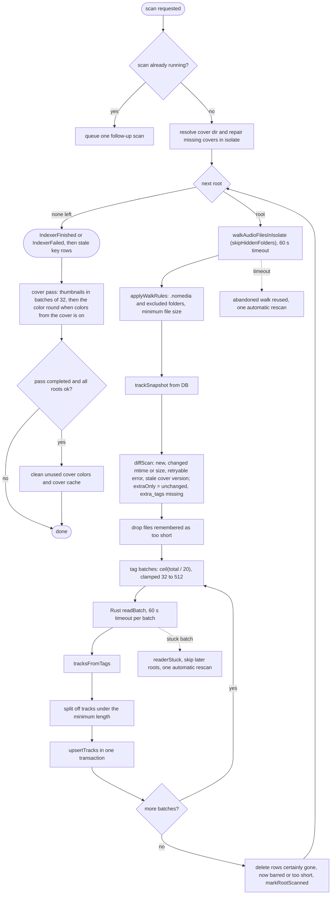

# System architecture: library scan

Part of [System architecture](system-architecture.md).

## 3. Library scan pipeline

Entry points: rescan button, Settings (add or change a folder), onboarding, adding a folder, and the startup rescan (`indexer/library_startup_tasks.dart`, after the first frame, when `rescanOnStartup` is on and a folder exists). A startup scan is quiet: the UI announces it only when it added, updated or removed something, or failed. With "Watch music folders" on, the folder watcher rescans by itself when files change (see [Folder watcher](#folder-watcher)). One scan runs at a time; a request during a scan queues one follow-up, and a user request during a quiet scan makes its result count as the user's.

Removing a folder deletes its `library_roots` row; `tracks` and `track_artists` go by `ON DELETE CASCADE`, and albums and artists are derived from `tracks`, so nothing is left behind. Changing a folder is a remove plus an add in one transaction (new root id), then a scan. A scan that is running when its root is removed drops that root's result silently (its next write fails on the foreign key). The play queue is not touched: it holds file paths. Removing a folder also deletes the cover colors no track uses and the thumbnails only that folder used (unless a cover pass is running; see [Cover colors](#cover-colors)); other unused thumbnails, such as those of songs deleted from disk, are cleaned by the next scan that finishes cleanly.

Rules that shape the pipeline:

| Rule | Where |
|---|---|
| Delete only when certainly gone. Unstattable, unreadable, empty (unmounted) or missing roots keep their rows. | `indexer/scan_diff.dart` |
| Scan rules (Settings > Library) apply after the walk, on the main isolate, by the pure `applyWalkRules`; the walk and `rootWalkerProvider` know nothing of them, except `skipHiddenFolders`: it decides which folders the walk enters, so the walk takes it as a parameter (`RootWalker`) instead of entering every dot-folder (`.cache`, `.git`) just to filter them afterwards. A folder below the root holding a `.nomedia` entry (file or link) is dropped with its subtree when `respectNomedia` is on; the root's own `.nomedia` is ignored. Files under `minFileSizeKb` are dropped. Everything dropped also leaves the unreadable, unstattable and empty lists, so tracks stored there are deleted by the diff. The walk result carries `filteredOut`, so a root emptied by the rules deletes its rows, while an empty mount (`filteredOut` 0) is still left alone. Changing a rule does not start a scan; it applies at the next one. Excluded folders (table `excluded_folders`, canonical paths) are blocked like `.nomedia` folders, matched with `isSameOrInside` (never SQL `LIKE`); one outside the root being scanned is ignored. The list is read at the start of every scan, inside the scan's `try`: a failed read fails the whole scan, as scanning without it would bring back tracks the user left out. `ExcludedFoldersController` accepts only a folder below a library folder (`ExclusionConflict`: same as a root, outside the library, already excluded; path errors reuse `RootRejection`), and adding or removing one starts a normal scan. | `indexer/scan_rules.dart`, `indexer/scan_diff.dart`, `indexer/excluded_folders_controller.dart`, `database/excluded_folder_queries.dart` |
| `minDurationSeconds` needs the tags: a row read with a duration under the minimum is not stored (a missing duration or failed tags are kept), and its old row, if any, is deleted. Stored tracks under the minimum are deleted at the end of the root's scan (`shortTrackIds`), unchanged files included. `ShortTrackMemo` (one per session) stops an unchanged short file from being read again on every scan; the summary counts only rows written. | `indexer/short_track_memo.dart`, `database/scan_filter_queries.dart` |
| Walk skips symlinked directories, FIFOs, sockets and devices; dot-folders below the root while `skipHiddenFolders` is on (default; a dot-named root is still walked); dot-files (`._x.mp3`, `.x.mp3`) always; and, in both modes, the junk folders of `isJunkFolder`: `lost+found`, `@eaDir`, `$RECYCLE.BIN`, `.Trash`, `.Trash-*`, `.Trashes`, the home trash (`/.local/share/Trash`), `.snapshot(s)`, `.zfs`, `.stversions`, `.recycle`, `#recycle`, `@Recycle`, `#snapshot`, `.@__thumb`, `.AppleDouble`. The walk counts nothing it leaves out; when a walk lists no file, `hiddenRowsBarred` counts the stored rows the hidden rules now bar and passes them to `diffScan(barredRows:)`, so a root holding only `.stfolder` and a briefly missing library still hits `rootEmpty`. The empty walk deletes rows only when every stored row is barred; one other row left (an unmounted drive with a stray `._x.mp3` row) keeps all rows (`barredRows < existing.length`). Barred rows are deleted (plays, favorites and playlist entries stay, keyed by path). An abandoned (timed-out) walk remembers the flag it started with; with the other flag it is not reused and no second walk is started until it ends. Turning the option off on a root such as `$HOME` walks every dot-tree on each scan (slow, may hit the walk timeout). Non-UTF-8 names are counted and skipped, rows kept. | `indexer/walk_audio_files.dart` |
| Scan statistics (Settings > Library) count what only a scan knows, per reason: `applyWalkRules` adds `nomediaOut`, `excludedOut` and `tooSmallOut` to the walk result (`filteredOut` keeps its meaning), `RootShortTrackRules.tooShortFiles` counts files under `minDurationSeconds` (remembered or newly read), and `RootScanResult.stats` carries them with the files the walk listed before the rules, summed by `ScanTotals`. A scan that ends without error publishes the sum in `lastScanStatsProvider`; it lives for the session only (nothing is stored), so Settings says "not scanned in this session" until one ends. The song, tag-error and cover counts come from the database (`scanDbStats`). | `indexer/scan_stats.dart`, `indexer/scan_rules.dart`, `indexer/root_short_track_rules.dart`, `database/scan_stats_queries.dart` |
| Permanent tag errors are not retried until the file changes or `tagReaderVersion` changes. Transient I/O errors are retried every scan. | `indexer/tracks_from_tags.dart`, `rust/src/tag_reader.rs` |
| Unchanged files whose `tracks.extra_tags` is NULL or older than `extraTagsVersion` (and that have no scan error) land in `ScanDiff.extraOnly`, not in `toRead`: after the normal batches `fillExtraTags` reads them with the same tag reader (no covers) and writes only `extra_tags`, guarded by id, mtime and size, in chunked transactions. It never goes through `upsertTracks`, which would reset `coverScanVersion` and re-key the row, and it counts as neither added nor updated. A transient read error keeps NULL and is tried again on the next scan; a permanent error stores `{"v":1}` so the file is not read on every scan. The pass publishes `IndexerScanning` reading progress over `extraOnly`; a timeout marks the reader stuck and ends the root with `SkipReason.timedOut`, like a normal batch. | `indexer/extra_tags_pass.dart`, `indexer/scan_diff.dart` |
| Automatic rescans do not chain. | `indexer/library_indexer.dart` |
| Artists are split by the artist rules of Settings (`artistSplitRulesProvider`, `database/separator_rules.dart`), read at the start of every batch and written with the rows: `upsertTracks(rows, artistRules:)` stores `keys_version = keysVersionFor(rules, grouping)`, the album grouping coming from the per-database registry (see "Album keys" in §7). A rules change mid-scan therefore leaves earlier rows with the old version, which the key backfill re-keys afterwards (see [Library database schema](system-architecture-database.md#7-library-database-schema)). | `database/separator_rules.dart`, `database/library_database.dart`, `indexer/library_indexer.dart` |
| Besides the other tags, the scan reads the language tag into `tracks.language` (`ItemKey::Language`, cut to 128 bytes at a character boundary). Files without it, such as most MP4 files, keep NULL. | `rust/src/tag_mapping.rs`, `indexer/tracks_from_tags.dart` |
| Rust reads a batch in parallel on the `kanaru-tags-N` pool and never fails the batch as a whole. | `rust/src/tag_batch.rs` |

State is a sealed class: `Idle`, `Scanning`, `Finished`, `Failed` (`indexer/indexer_state.dart`). The UI shows progress through `ScanProgress`.

### Folder watcher

`folderWatcherProvider` (`indexer/folder_watcher_provider.dart`, started with the startup tasks and kept for the session) runs only when `libraryScan.watchFolders` is on and a library database exists; switching the setting off drops every inotify watch and timer. It never touches the database itself.

- **What is watched.** One `Directory.watch` per folder: Dart on Linux ignores `recursive`. The folders are the ones the last scan saw, after the exclusion and `.nomedia` rules, published once per scan in `scannedFoldersProvider` (the indexer writes it right after its loop over the roots, before a failure is rethrown or the cover pass starts). A root that is `missing` publishes no folders; a root whose walk timed out or threw keeps its previous ones. When nothing was published yet and no scan is running (`rescanOnStartup` off), the watcher lists the folders once without scanning (`listLibraryFolders`, no track is touched).
- **Events.** Created audio file, folder or `.nomedia`; modified audio content (not attributes); deleted audio file, `.nomedia` (only while its folder is watched, so creating one is seen, deleting one that already hides its folder is not) or watched folder; a move counts by its old and new name, so an rsync temporary name renamed to `x.flac` is seen. A created folder (and its subfolders) is watched at once; the next published list corrects it. Dot-folders are never watched, whatever `skipHiddenFolders` says (the published list is filtered with `hasHiddenSegmentBelow`, new trees with `isSkippedFolder(skipHidden: true)`): with the option off, changes inside hidden folders show up at the next scan, not live, and big dot-trees cannot exhaust the watch budget.
- **Timing.** The scan starts 3 s after the last event, at most 60 s after the first of a burst. Files modified in the last 2 s are left alone by that scan (`settledBeforeMs`, their rows stay) and, if any, the watcher schedules one more scan; files that never settle slow this to once a minute. Only a file dated at most 5 s ahead of the scan start can be "still being written"; one dated further ahead (wrong clock, archive dates, FAT time zones) is read normally, or it would be deferred forever. After a failed scan the next one waits 60 s, so the error snackbar does not repeat every few seconds.
- **Scan.** `LibraryIndexer.scanForChanges()`: quiet, queues one more pass when a scan is running, and unlike `scan()` neither clears the skipped covers, nor re-arms automatic follow-ups, nor makes the cover pass yield.
- **Budget.** At most a quarter of `/proc/sys/fs/inotify/max_user_watches` (8192 if unreadable), as the budget is shared with the IDE and sync tools. More folders than that, or `ENOSPC` while adding a watch, cancels every watch and sets `WatchStatus.limitReached` for the session (Settings says so); the stored setting is unchanged. A folder that fails otherwise (permission, vanished) is dropped until the next published list, and the stream closing after the error is not a change.
- **No loops.** A scan that finds a root missing publishes no folders for it, so its watches go and no event follows. Many watches closing at once (a deleted root) give one coalesced scan.
- **Not detected.** Deleting the `.nomedia` of a folder the scan dropped (the folder is no longer watched), unmounting or replugging a drive and renaming a root show up only at the next scan, as Dart reports neither for the watched folder itself.

### Cover colors

"Colors from the cover" (UI-03, `DisplayPrefs.colorFromCover`, on by default) tints the app with the playing cover. The colors of a cover are worked out once, from its thumbnail, and stored per cover key in `cover_colors`.

| Piece | What it does | Where |
|---|---|---|
| Color function | Reads `<cover dir>/<key>` (at most 1 MiB, JPEG header at most 512 px, cover decode limits), shrinks it to 112 px, clusters it (Wu, then each distinct color counted toward its nearest cluster in Lab space). Seed = `Score` with one color wanted, or `0` when no cluster fits or the pick has HCT chroma below 8 (a gray cover). Palette = up to five clusters, most common first. A bad key or file fails only its own entry. | `rust/src/cover_colors.rs`, `rust/src/api/cover_colors.rs` |
| Stored row | `seed` (opaque ARGB or `0`), `palette` (lowercase 8-digit ARGB hex joined by commas), `algo_version = coverColorAlgoRevision * 100000 + coverThumbnailSize` (now `100512`). Another version or a damaged row counts as missing and is written again. | `core/cover_colors/cover_palette.dart`, `core/database/cover_color_queries.dart` |
| Scan | After the cover pass has made every thumbnail, and only while the setting is on (`LibraryIndexer._coverPass` passes the extractor and reads `display.colorFromCover` before each batch), a color round lists the keys of the scanned folders missing colors and works them out 32 at a time on the cover threads (`background: true`). It stops between batches for a waiting rescan, app exit, or the setting going off; a batch that comes back after the setting went off is not stored. It also gives way to files the folder watcher saw change (`shouldYieldColors`), since the first round after turning the setting on covers the whole library. A key that fails, or every key of a batch that times out, is skipped until the app restarts (`CoverPassProgress.skipColorKeys`); a timed-out call may still run on the cover threads, so no color round starts until it returns (`colorCallPending`). The round never marks the cover reader stuck and never changes whether the pass completed. The query of missing keys reads only rows that are absent or look damaged. | `core/cover_colors/cover_color_round.dart`, `core/indexer/cover_pass.dart` (`runCoverPass(colorExtractor:, shouldExtractColors:)`), `core/indexer/library_indexer.dart` |
| Orphans | One statement deletes colors no track points at: `DELETE FROM cover_colors WHERE cover_key NOT IN (SELECT cover_key FROM tracks WHERE cover_key IS NOT NULL)` (`deleteOrphanCoverColors`). Without `IS NOT NULL`, one track without a cover would make it delete nothing. It runs at the end of a clean scan (`cleanCoverCache`), after removing a folder and after replacing one; `make reset-library` empties the table. Repairing missing thumbnails keeps colors: a key is the hash of the original image, so a rescan brings back the same key. | `core/database/cover_color_queries.dart`, `core/indexer/cover_cache_cleanup.dart`, `core/indexer/library_roots_controller.dart` |
| Playing | `playingCoverPaletteProvider` reads the setting first (off: touches nothing else), then the playing art; only one of our thumbnails counts. Stored colors are used as they are; missing ones are worked out at once on the calling thread (`background: false`, 2 s timeout) and stored. A failure is logged and the key skipped until restart. A run made stale by a track change or the setting going off stores nothing and skips nothing. `appCoverPaletteProvider` keeps the previous colors while the next load, and goes to `null` only on an answer of "no colors". | `core/cover_colors/playing_cover_palette_provider.dart` |
| Theme | `KanaruApp` passes the seed (`null` for a gray cover) to `buildTheme(..., coverSeed:)`, which wins over the system accent; `themeAnimationDuration` is always zero (a theme animation lerps `ThemeData` and rebuilds every `Theme.of` dependant each frame: 100-180 ms a frame in Debug), so a new cover, or a light/dark switch, changes the colors at once. `buildTheme` caches its result by (platform scheme, brightness, seed), 8 entries, so a rebuild of the shell with the same inputs reuses the same `ThemeData`. Turning the setting on does not start a scan: the playing track gets its colors at once, the rest at the next scan. | `lib/app/app.dart`, `lib/app/theme.dart` |
| Now Playing | `CoverTintBackground` (`features/player/cover_tint_background.dart`) paints the page: the surface, plus a translucent top-left to bottom-right gradient of up to four palette colors (one color gives itself and a shade of it) over it, so a new cover or a light/dark switch shows the new surface at once and only the tint fades (a brightness change restarts the gradient without a fade), each faint enough that `onSurface` text keeps 4.5:1 contrast. Opaque, in a `RepaintBoundary`, fading over 300 ms (`coverThemeTransition`; none with reduced motion), the one cover color animation left. A gray cover still tints the page. | `features/player/cover_tint_background.dart`, `shared/readable_gradient_stops.dart` |
| Thumbnails after removing a folder | No scan follows a removal, so `removeRoot` deletes the thumbnails only that folder's tracks used (older than the removal, real files in real shard folders, as the scan cleanup does). The thumbnail part is skipped while a cover pass runs (checked before and after reading the keys in use; it may be writing one of those keys for another folder); that scan's cleanup deletes them. A pass that starts during the deletion itself can lose a thumbnail it just pointed a track at; the next scan's repair of missing covers makes it again. Removing the last folder therefore leaves no thumbnail behind. `replaceRoot` leaves thumbnails to the scan its caller runs next. | `core/indexer/library_roots_controller.dart`, `deleteUnusedThumbnails` in `core/indexer/cover_cache_cleanup.dart` |
