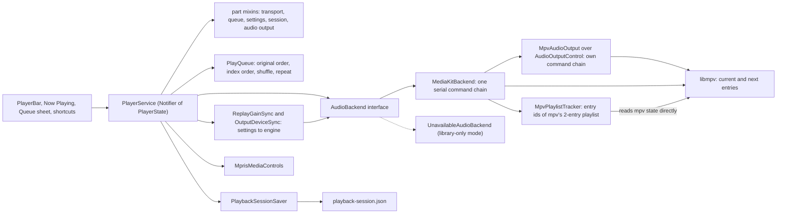

# System architecture: playback

Part of [System architecture](system-architecture.md).

## 4. Playback

The Dart `PlayQueue` is the source of truth. The engine holds at most two entries: the current one and the next one, so gapless transitions do not need the whole queue in mpv.

Behavior:

- **Commands** (`openTracks`, `jump`, `next`, `previous`, `playPause`, `seek`, `setVolume`, `setShuffle`, `cycleRepeat` (off, all, all shuffled, one), `moveTrack`, `moveToPlayNext`, `removeTrack`, `clearQueue`, and others) go through `PlayerService`. `upNextRun` is the number of play next tracks right after the current one (the queue panel marks exactly those; stray marks left after Previous, a jump or unshuffle stay invisible). A play next track dragged between the playing track and the end of the other play next tracks (inclusive) keeps its mark, anywhere else it loses it, and a plain track never gains one; `moveToPlayNext` moves a queued track (also a played one) behind the block and marks it, with the guards in core. Errors surface as a stream; `seeked` is also a stream. `replacedQueues` announces the old queue each time `openTracks` or `openShuffled` replaces a queue that held at least one track, and when `clearQueue` (the Clear queue menu item) keeps only the playing track; in both cases `state.queue` already holds the new one. Restoring the session, play next, add to queue, the engine moving on, repeat, shuffle and the other queue edits (remove, move) never announce. Like `seeked`, it is a new stream after each provider rebuild, so listeners subscribe again.
- **Queue** is immutable: the original list never changes; order is a list of indexes. Shuffle is Fisher–Yates with the current track first; un-shuffling restores `unshuffledOrder`. Stable keys make duplicate files safe.
- **Repeat**: `off`, `all`, `allShuffled`, `one`. `allShuffled` (repeat all, every pass in a new random order; `RepeatMode.wrapsQueue` is true for both repeat-all modes) plays a pass in the order it has. On the last track of a pass (`PlayQueue.endsShuffledPass`) the engine is handed no next track (`engineNextIndex`), so the pass boundary has a short gap; when the engine finishes that track (`_onCompleted`) or the user presses Next on it, the queue gets a fresh random order (`PlayQueue.nextShuffledPass` in `play_queue_pass.dart`: shuffle on, the first track is never the one that just ended, the order before the first reshuffle is kept for shuffle-off) and plays from index 0. Nothing else reorders: jump, Previous (which does not wrap back under `allShuffled`), open, restore, removal and `setRepeat` leave the order alone; an engine move past the end with a next handed before the mode was chosen reshuffles around the track now playing. `one` sets mpv `loop-file` to a finite count (10000) and observes `remaining-file-loops`: each decrement is one loop, reported as `AudioBackend.looped` with the track and followed by re-arming the count. `PlayerService` ignores a loop whose track is no longer current, otherwise it starts a new playthrough at position 0. Seeks, opens and track changes never count. **Counted repeat** (`PlayerState.repeatTimes`, set by `setRepeatTimes(1..99)`, 0 ends it) is an overlay on the base mode in `queue.repeat`: the current track plays that many extra times, then playback goes on in the base mode. While counting, the engine runs in `one`; each `looped` event takes one off and starts a new playthrough, and at the start of the last play the engine gets the base mode back (`setRepeat`), so the track ends and playback moves on as before. Arming under `one` makes the base `off`. Any track load (`_play`, the engine moving on, the queue stopping) and any `setRepeat` (also with the mode already set) end the count and reset the engine before the next `open`; a sleep stop at a loop does too. It is not persisted, and it cannot be armed after the queue ran out. MPRIS shows `Track` while counting; `Track` then is a no-op and `Playlist` over a repeat-all base only ends the count.
- **Endless queue** (QUEUE-15, `PlaybackPrefs.infiniteQueue`): `next` and `previous` use `PlayQueue.manualNextIndex`/`manualPreviousIndex(wrap:)`, which fall back to the other end of the queue when the setting is on (a one-track queue plays its track again). `nextIndex`/`previousIndex` are unchanged, so the engine moving on by itself, the end of the queue and ReplayGain's neighbours still follow repeat. The player buttons and MPRIS `CanGoNext`/`CanGoPrevious` read the same functions; MPRIS listens to the setting and signals the change.
- **Play/pause fades** (PLAY-02, `fadeOnPlayMs`/`fadeOnPauseMs`): `PlayPauseFader` (`playback_fade_controller.dart`, one per provider build, held by the transport mixin and tied to the build through `_seeked`) ramps the engine with `AudioBackend.setVolume(volume × gain)` every 25 ms (`PlaybackFade`, at most one volume command in flight; time from `playbackFadeClockProvider`). `PlayerState.volume` never changes, so the session and MPRIS never see a ramp. `playPause` flips `playing` at once; a fade-out pauses the engine when it ends, then sends the volume back; a fade-in sends volume 0, `play`, then ramps after `play` returned. Pressing again mid fade turns it around from the current gain. `seek`, `stop`, `jump` (so `next`, `previous`, opening) settle a fade first, synchronously: a waiting pause, then the volume, before their own engine calls. A new playthrough that does not go through the transport (removing the playing track, clearing the queue, the engine moving on) or a changed volume/mute is noticed at the next tick (≤ 25 ms) and settles it too. A fade-in sends volume 0 and `play` together before awaiting either, so a pause or settle that comes meanwhile always lands after the `play`. A provider rebuild drops a running fade without touching the old engine. A fade-out is cut to the time left in the track minus 250 ms, so the engine does not move on while it fades. `pause()` (MPRIS `Pause`, `Rate = 0`, the exit hook) never fades and ends a fade-out at once. While fading out, `playing` is already false but the engine still plays: the saved position can be up to the fade length early.
- **Failures**: a track that never reports a duration counts as failed. When every queued track fails in a row, the queue stops.
- **ReplayGain and output device** (`ReplayGainSync` and `OutputDeviceSync`, built by `PlayerService.build`, fed from `settingsProvider`'s `playback` group, the backend's device list and the queue): any change of a ReplayGain field sends one `setReplayGain` (mpv `replaygain-preamp`, `replaygain-clip`, then `replaygain`, so the mode comes last); a value equal to what was sent is not sent again, and default settings send nothing. `auto` picks album gain when the previous or next track in play order has the same album key as the playing one (read from the `tracks` table by path through `album_run_lookup.dart`; no row, no album or keys not computed yet is track gain), and fixes the choice for the whole turn of that track. A turn is a number `PlayerService` bumps where a track really starts (every `_play`, every move of the engine to the next track), not for repeat one loops or queue edits (shuffle, play next, remove, clear queue): those never change the level of what is playing, only the next turn. Keys of the tracks around the current one are read ahead into a 256 entry cache that also keeps "no album" answers and never asks twice for a path in flight (a key is never refreshed within a session), so moving on inside an album decides before `open` reaches mpv (`listenSelf` runs inside `state =`, synchronously). `AudioBackend.setReplayGain` and `setAudioDevice` run in the own chain of `AudioOutputControl` (media_kit free, so it is unit tested; `MpvAudioOutput` only wires it to the player), not the playlist chain, and `dispose` waits for it. The output device is sent only if it is `auto` or exactly one entry of `selectableDevices` (`<driver>/<device>`; `auto` and bare driver names are left out) has that name, because mpv ignores a failed `audio-device` change silently. A saved device that leaves the list goes to `auto` at once and is used again only after it stayed 2 s (a Bluetooth sink flickers on a profile change, and each change reopens the output and seeks). A device that is listed but fails to open (mpv logs `Could not open/initialize audio device`, matched as text) is set back to `auto` by the backend and shown through `audioOutputFailedDeviceProvider` (Settings > Advanced; the mark is cleared when a new engine starts; a late failure report of a device that is no longer the saved one only re-applies the saved choice; choosing that device again in the dialog calls `retry()`, which clears the mark so the saved device is tried again even though the settings did not change); the track that was playing is skipped like a broken one. Device names are never logged, only the driver.
- **mpv settings**: `gapless-audio=weak`, `cache-on-disk=no`, `demuxer=lavf`, `demuxer-lavf-o=protocol_whitelist=file` (`mpv_startup_options.dart`, set before the first open). The last two stop mpv from following URLs inside a local file: a file named `.mp3` that holds an M3U or HLS playlist made mpv's playlist demuxer fetch them (measured); libavformat refuses such a file and its nested opens may only use local files. `access-references=no` is not used: media_kit's `open` loads the track through `loadlist` of a temporary playlist file, which that option refuses. Volume is 0 to 100. mpv's own log lines are forwarded as WARNING (SEVERE for errors), except `lavf: avformat_open_input() failed`, logged at FINE: a new `open` aborts the previous entry's file open, and mpv prints the same line as for a broken file, which the tracker reports on its own.
- **Session** (`playback-session.json`, next to `settings.json`): restores queue, position and volume, always paused. Writes happen right away on track change, pause, stop and seek; 500 ms debounce for queue, shuffle, repeat and volume; every 10 s while playing. A saved position at or past the saved track length restores as 0. A stop made before the restore runs keeps the player stopped, with the track loaded paused at 0. Tracks are stored by source URI, never by proxy URL. A thumbnail from the cover cache is stored as a `coverKey` (path below the cover folder) and resolved with the current cache folder on load, which `main()` takes from the environment, not from the library database; other art keeps its `artUri`. A track's `album` and `year` (shown on the queue row) are stored only when set; a wrong type on load drops that label, not the session. The file version stays 1, so an older build reads those tracks without art and drops the keys on its next save. Repeat all shuffled is written as `"repeat": "all"` plus `"reshuffle": true`; an older build reads it as repeat all, and a `reshuffle` of another type is ignored on load. Invalid files move to `*.invalid`; a newer format version is read-only. Saving is frozen after restore until a track loads or the user acts, so an unmounted drive cannot overwrite the session. On load, a track whose URI is not a plain absolute path to an audio file (no `/` start, a NUL, or a non-audio extension: `http://`, `edl://`, `av://`, `file://`, relative paths) is dropped from the queue, with a warning that counts them and never shows paths; the order, the unshuffled order and the current index are renumbered, and if the current track was dropped the one that took its place becomes current, at position 0. The check is synchronous and does not look for the file, so a library on a drive that is not mounted keeps its queue. "Play next" tracks that have not played yet are kept as `upNext` (indexes into `tracks`, optional, left out when empty, so the version stays 1 and an older build ignores it); on load, broken or out-of-range entries are dropped without failing the session, and only entries still after the current track come back, so the next "play next" goes behind them as before the restart. Saving never encodes on the UI isolate: `PlaybackSessionFile` hands each write to `Isolate.run` (`session/playback_session_off_thread.dart`), which encodes, writes `<path>.<pid>.tmp` and renames it. The parts that grow with the queue (`tracks`, `order`, `unshuffledOrder`) are encoded only when their list object changed since the last successful write (queue lists are never edited in place) and their JSON text is kept for the next write, so the save every 10 s while playing re-encodes only the small fields. Writes stay one at a time and the newest pending snapshot wins; the restore still reads the file synchronously at start. Measured with a 50k-track queue (12.7 MiB file; `test/core/player/session/playback_session_save_benchmark_test.dart`, `KANARU_BENCH=1`, JIT `flutter test`, 8 cores under load average ≈ 21 from parallel builds, so absolute numbers are high; longest UI-isolate stall, best/median of 5): position-only save 1402/1511 ms before, 21/38 ms after; queue-changed save 1120/1450 ms before, 135/159 ms after (copying the tracks to the isolate is what remains); save + flush 1535 ms before, 510 ms after.
- **Position to UI** (`features/player/seek_follow_step.dart`): `PlayerState.position` keeps every mpv tick (listen stats, fades, session, MPRIS and the lyrics line lookup need it). The seek bar and strip follow it in a step of 250, 500 or 1000 ms, the smallest at least as long as one logical pixel of the track, so they redraw at most 4 times a second (the time label and the spoken value change once a second, on a step boundary). In Split the track column (cover, seek slot, times) is outside the auto-hiding header, so the slot repaints at its follow step (at most 4 a second) and the elapsed label once a second even while the header is hidden, as a shown footer did before; the hidden header still mutes its own tickers (the sleep countdown label). The seek bar is two time labels around a swappable track (`SeekBar(track:, trackHeight:)`, default `SeekTrack` and 24 px), each part in its own `RepaintBoundary` inside a fixed-height row; `NowPlayingSeekSlot` is the track every wide Now Playing mode uses, so a new seek visual replaces that one widget. It watches `display.waveformSeekBar` (Settings -> Appearance, on by default): on it is `WaveformSeekTrack` (`features/player/waveform/`); off it is the flat `SeekTrack` and no waveform widget is mounted, so nothing is decoded or prefetched. `WaveformSeekTrack` keeps the `WaveformController` attached while mounted and draws the waveform in 48 px, or the flat track while there is none. It keeps the step rule: bars are recorded once into two `Picture`s per waveform, size, device pixel ratio, duration and colours (`WaveformPictures`), and a tick only moves the clip split between the played and the rest picture, with no path or picture built per tick. The slot's height is `nowPlayingSeekSlotHeightProvider` (48 px with the waveform, 24 px with the setting off, so a toggle relayouts once); Split's reserve (`splitReserve`, `splitCoverSide`), Cover only's reserve and the Lyrics only strip's `SeekBar.trackHeight` read it. The player bar and the narrow page still use the 24 px flat `SeekBar()`. On GTK every frame composites the whole window (~5 ms of CPU), so the number of frames, not the repainted area, is the cost.
- **Exit hook** (`main.dart`, `core/player/app_exit_flush.dart`): window_manager disconnects Flutter's close handler, so the app calls `setPreventClose(true)` (after `runApp`, only when the desktop window was set up) and handles `onWindowClose`. Order: hide the window, pause, flush (capped at 2 s), `destroy()` (1 s timeout, then `exit(0)`); a second close while flushing calls `exit(0)`; the close request that `destroy()` itself makes GTK emit is ignored, and a 1 s timer after a successful `destroy()` calls `exit(0)` if the process is still alive. The flush is `ListenRecorder.flush` (a checkpoint of the open playthrough: recording goes on, the same row is updated) and `PlaybackSessionSaver.flush` (waits for an in-flight write, saves again if it failed or a change is pending, waits again). Not covered: SIGTERM, SIGKILL and a logout kill run nothing, so the 30 s listen and 10 s session checkpoints bound the loss; a blocked UI isolate leaves the close ignored. media_kit is not disposed: its delayed `mpv_terminate_destroy` is crash-prone.
- **Sleep timer** (PLAY-14, `sleep_timer*.dart`, session only): `sleepTimerProvider` pauses playback (never stops; the queue stays) after 1 to 720 minutes, after 1 to 20 tracks, or at the end of the track, the album or the queue. The player has one hook for the track-based modes, `PlayerService.setStopAfterCurrent`: while it is on, the engine is never handed a next track (`_queueNext` and `_play` hand `null`, and turning it on withdraws a next already handed), so `_onCompleted` loads the next track paused (with no next it ends as before); under repeat one the looped track rests paused at 0 (engine pause and seek, like `stop()`, without a `seeked` event); if the engine already moved on to a next track handed before the flag (the withdrawal still on its way), that track rests paused at 0 the same way. Under repeat one, end of album and end of queue stop only when the current track is the last of its album or of the queue; otherwise it just loops. Each stop clears the flag and is announced once on `sleepStops` (synchronous, new per build; a rebuild turns the flag off and the timer sets it again on the next queue change). A disposed timer clears the flag synchronously (`releaseStopAfterCurrent`, the next track handed back in a microtask). The timer recomputes the flag on every queue change: always on for end of track; on the last track in play order for end of queue (whatever repeat or the endless queue say); for end of album when the next track in play order has another album key or none follows (keys through `AlbumRunKeyCache` like ReplayGain's; a track without a key is its own album; while a new pair is read the timer assumes a stop, then follows the answer, and the track after the next one is read ahead so moving on inside an album finds its pair cached; a queue edit made while the keys are read can pause one track early; a late answer for a pair that is no longer current is dropped). The tracks mode (`startTracks`, current track included, `tracksLeft`) counts tracks the engine finishes by itself through `PlayerService.trackEnds` (synchronous, new per build, sent after `state` shows what follows): an advance, a completion, or a repeat-one or counted-repeat loop each count once; a failed track, a sleep stop, skip, previous, jump, seek and open do not. The flag is on while one track is left; `addTracks(+1/-1)` moves it (never below 1 or above 20), and when the queue runs out before the count the timer turns off. `SleepTimerPlayerEvents` follows both streams across player rebuilds. The minutes mode counts from a deadline on `playbackFadeClockProvider`, a monotonic `Stopwatch` (Linux `CLOCK_MONOTONIC`), so time spent in system suspend does not count; it counts also while playback is paused (`pauseCounting` holds it); +/- minutes are capped at 720 and taking time off is refused unless more than that is left. Over the last 10 s, while playing, `PlayPauseFader.fadeOutForSleep` ramps the engine to silence without flipping `playing` or pausing; unlike the play/pause fades it goes on across the engine moving to the next track, while a volume or mute change, seek or jump settles it and the user's play/pause turns it into a normal fade. A sleep fade interrupted that way is not started again in that countdown, so the timer pauses at zero without one; a new start, added time or resumed counting arms it again. At zero the player `pause()`s without a fade, which settles the ramp: engine pause, then the user's volume. Expiring while paused only turns the timer off. `PlayerState.volume` never changes.
- **Not built**: crossfade, volume above 100%, speed and pitch, equalizer.

### Waveforms

The native side decodes a whole track into at most 1000 loudness levels for the Now Playing seek bar and caches them (the cache keeps itself bounded). The Rust half is `api/waveform.rs`; the Dart half (`core/waveform/`) loads the playing track's waveform and prefetches the next one. Only the waveform seek bar of the wide Now Playing modes uses it, and only while "Waveform seek bar" is on.

| Part | Behavior | Files |
|---|---|---|
| API | `begin_waveform_job()` returns a job id (sync, from 1, only rises, so it stays unique across hot restarts and parallel tests) and registers a cancel flag for it. `load_waveform(path, cache_dir, job)` returns a `TrackWaveform { status, levels, duration_ms }` with status `Ready`, `Unsupported` (no decoder), `Failed` (broken file or beyond the limits: the same file version fails again, and a negative cache entry says so), `Busy` or `Cancelled`. `Busy` is temporary and means nothing was remembered: the file could not be read now (gone, unreadable mount, not a regular file), the decode stalled, the thread cap was reached, a thread died, or the id was never begun; callers must not memoise or cache it. Every begun id must be passed to `load_waveform`, which frees its registry entry. `cancel_waveform(job)` (sync) sets only that job's flag: before the load started it returns `Cancelled` without work, during the decode it stops at the next packet and the call returns within about 100 ms; an unknown or finished id does nothing. An empty `cache_dir` uses no cache. | `rust/src/api/waveform.rs`, `rust/src/waveform_job.rs` |
| Decode | symphonia 0.6.1 (pure Rust, MPL-2.0): MP3, FLAC, Ogg Vorbis, AAC (MP4 and ADTS), ALAC, WAV. Not decoded, so `Unsupported` and a flat seek bar: Opus (no decoder in symphonia), APE, WavPack, DSD, and AIFF (its reader is left out to keep the library growth under 2 MiB). APE, WavPack, DSD and AIFF are refused by extension or first four bytes before probing, because symphonia's MP3 reader takes their bytes for a few MP3 frames. The `id3v2` feature is always on, so a leading tag with a big cover is skipped, not scanned as junk. Samples go through `f32`; all channels count in the loudness. | `rust/src/waveform_decode.rs` |
| Limits (untrusted files) | `Failed` (cached as negative) for a sample rate outside 8 000 to 768 000 Hz, channels outside 1 to 32, a mid-stream change of either, more than 24 h of decoded audio, more than 32 packet decode errors in a row, or more than 1000 packet errors and container resets in total (a chained Ogg album needs one reset per track). No packet for 10 s (stall) is `Busy`, not cached. The limits live in `waveform_decode_limits.rs`. Memory spent on tags is bounded by the tag sizes in the file. The first audio track that has a decoder is used. Memory does not depend on the length: a truncated file plays up to where it ends, and a header claiming more data than the file holds decodes what is there. | `rust/src/waveform_decode.rs`, `rust/src/waveform_decode_limits.rs`, `rust/src/waveform_job.rs` |
| Levels | `LevelAccumulator` keeps 8192 slots (sum of squares and sample count), each 10 ms at first; when all are full, neighbours merge and the window doubles, so memory is about 128 KB for any length and a slot is always a whole number of frames. `finish` merges the used slots into `min(1000, slots)` buckets, takes the RMS of each (RMS rather than peak, because loud masters sit near 0 dBFS everywhere), divides by the loudest bucket, takes the square root so quiet parts stay visible, and scales to 0..=255. Silence is all zeros; a clip under 10 ms has no levels. `duration_ms` is the decoded frame count over the sample rate, so levels and time line up even for VBR MP3 without a header. | `rust/src/waveform_levels.rs` |
| Display stretch | The seek track does not draw the stored levels as they are: `waveformContrastLevels` (`features/player/waveform/waveform_level_contrast.dart`) squares them back to linear loudness and maps the track's 10th percentile to 0 and its 99th to 255 (gamma 1.0) through a 256-entry table, once per recording (a key change, not per tick). A flat track (when the floor is within 5 % of the ceiling in linear loudness) keeps full height, silence stays zero, and a ceiling of 0 falls back to the loudest level so a short sound in a quiet file survives. The stored scale and the cache are unchanged. | `features/player/waveform/waveform_level_contrast.dart`, `waveform_pictures.dart` |
| Job thread | Each load runs on its own `kanaru-waveform` OS thread (8 MiB stack, nice at least 10, `catch_unwind` around everything including the priority call), never on the bridge worker or the cover pool. The bridge worker waits for the result in 100 ms slices and returns `Cancelled` on cancel, `Busy` when the thread died without a result or no packet was decoded for 10 s. A read stuck on a dead mount therefore frees the worker after 10 s and leaves one thread behind; at most 2 waveform threads live at once, a third load is `Busy` at once. The thread opens the file once, with `O_NONBLOCK`, and checks on that handle that it is a regular file (a FIFO neither blocks the open nor is read); the same handle gives the cache key and the decode. After sending its result a job thread may run the cache sweep (one per folder at a time), so a thread can outlive its slot. | `rust/src/waveform_job.rs`, `rust/src/waveform_control.rs`, `rust/src/thread_priority.rs` |
| Cache | One file per audio file version, `<cache>/waveforms/<64-hex blake3>.kwf`, named by the hash of path, size, mtime, ctime and inode (ctime and inode catch a re-tag that restored the old mtime). Little endian: `KNWF`, version byte (1; the level scale is behind it), kind (0 levels, 1 negative), 2 zero bytes, sample rate, frames, count, levels. A **negative** entry records that this exact file version failed for good (broken stream, limits), so it is not decoded again on every play. Never cached: a missing or unreadable file (IO), a stall, `Unsupported`, a cancel, a clip too short to draw. Reads open the entry with `O_NONBLOCK | O_NOFOLLOW` (a FIFO or symlink at the name is a miss), accept a regular file of at most 4 120 bytes (a 24-byte header and up to 4 096 one-byte levels, checked on the handle) and reject a wrong magic, version, kind, count or length; a write failure is reported once and the result is still returned; writes go through a temp file and a rename (`cover_cache::write_atomic`); the lookup, compute and store step is `waveform_cache::lookup_or_store`. **Cleanup** (`waveform_cache_sweep.rs`): a sweep deletes `.kanaru-tmp*` temp files older than 5 minutes (a crash between the temp write and the rename), entries not used for 90 days (orphans of edited or moved files, files of an older format), and, above 20 000 entries, the least recently used by modification time down to 18 000. A disk hit sets the entry's modification time to now (`futimens` on the open handle, so a symlink or FIFO is never touched), so eviction and expiry go by last use; an entry with other hard links is not touched, a failure to set the time is reported once by kind and otherwise ignored, and that entry then ages as written. Only regular files with those exact names are touched (no sub-folders, links, FIFOs or other names), the folder must be absolute and owned by the user (a link to it is followed only if the user owns the link too), the folder is listed completely (at most 80 000 matches) before anything is deleted, and each file is checked again right before its unlink; a write landing in that gap costs one re-decode. A modification time more than a day in the future counts as idle. It runs on the job thread after the result is sent, so the result never waits: at the first job of a run (hit or miss), 24 hours after the last sweep, and when the estimated count passes the cap (the count kept by the last sweep plus the writes since; at least 2 000 above what failed deletes left). A failed sweep is reported once, by kind and without a path, and retried after 24 hours. Known limit: with no jobs (the setting off, Now Playing never opened) there is no sweep; the cache then stays at most as large as the cap. | `rust/src/waveform_cache.rs`, `rust/src/waveform_cache_sweep.rs` |
| Dart reader | `WaveformReader` (`beginJob`, `read`, `cancel`) hides the native calls; `RustWaveformReader` loads the library on first use and maps the status. A read ends as a sealed `WaveformReadResult`: `WaveformFound`; `WaveformAbsent` (`Ready` with no levels, `Unsupported`, `Failed`: final, remembered); `WaveformRetry` (`Busy`, `Cancelled`: temporary, never remembered). `waveformReaderProvider` defaults to `NoWaveformReader` (all absent), so tests never load the native library; `main.dart` overrides it with `RustWaveformReader(resolveWaveformCacheDirectory(...))`. | `core/waveform/waveform.dart`, `core/waveform/rust_waveform_reader.dart` |
| Controller | `waveformControllerProvider` (keep-alive `Notifier`) holds `PlayingWaveform? = ({uri, waveform})` for the playing local track. `build` only listens (one listener on the current uri and the next local path via `PlayQueue.nextIndex`, so both move as one decision), never watches, so the notifier is never recreated and a view may keep the instance it read in `initState`. On a track change the state is set synchronously from the memory cache (hit: the waveform; miss or none: `null`). Views call `attach()` and `detach()`; while at least one is attached (hidden ones count) it reads the current track, then the next, one native job at a time. A running job that is neither the new current nor the new next is cancelled; a prefetch that became current keeps running. The last `detach` cancels after a microtask (`scheduleMicrotask`, no `Timer`), so a view swapped for another in the same frame cancels nothing. Every begun job is read, even a cancelled one, which frees it natively. A path that ends `WaveformRetry` (not cancelled by the controller) or whose read throws (logged without the path) is skipped until the next track change or `attach()`, so a missing file is tried once per such event and never in a loop. | `core/waveform/waveform_controller.dart` |
| Memory cache | 8 entries by path, least recently used out first; a `null` value is a remembered "no waveform" (a path is read once until evicted). Not stored: retries and cancelled reads. A file rewritten mid-session is seen again after eviction or a restart. | `core/waveform/waveform_memory_cache.dart` |
