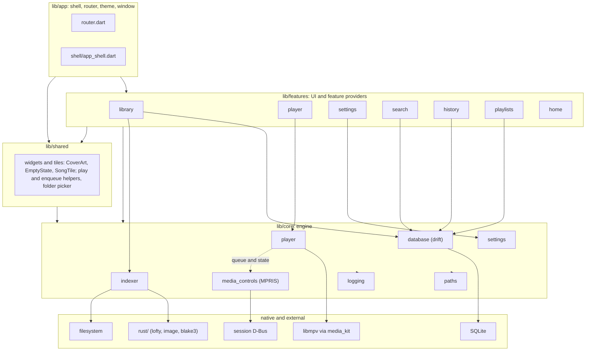
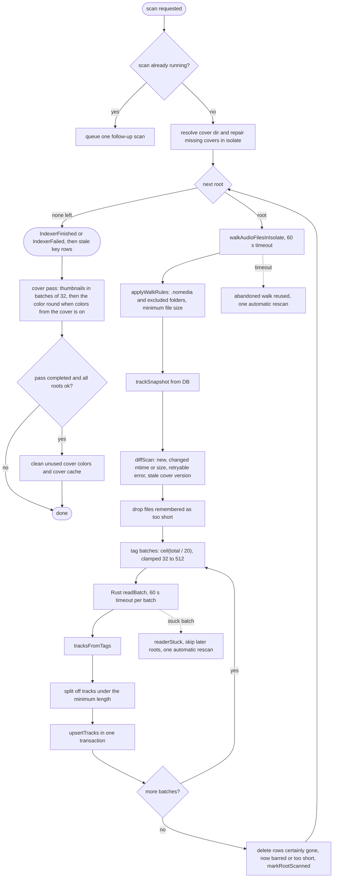
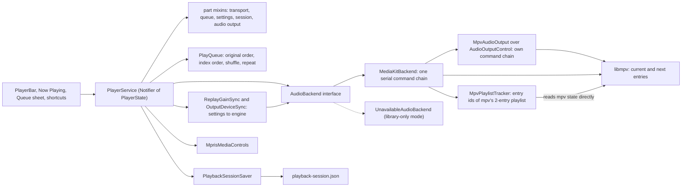
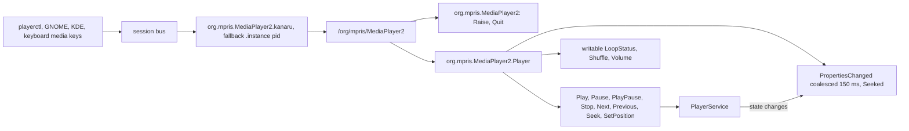
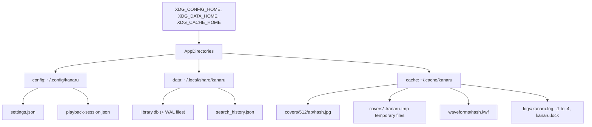
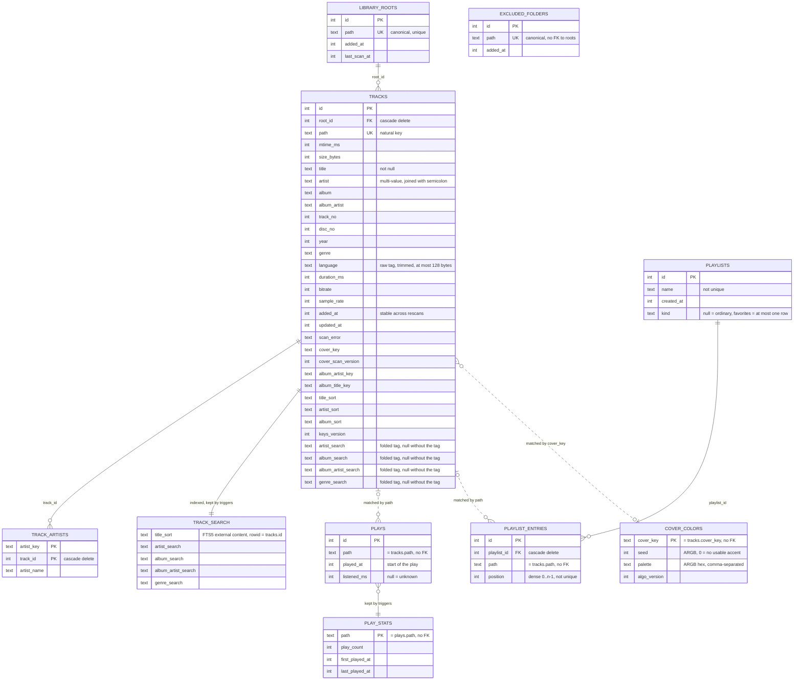
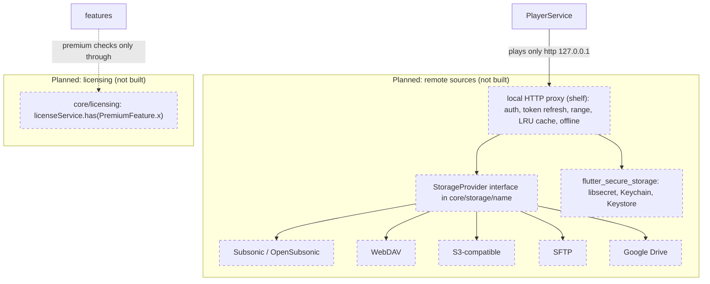

# System architecture

How Kanaru is put together at runtime: layers, startup, the library scan, playback, system media controls, storage, and the database schema. Items marked **Planned** are not in the code yet.

Related: [codebase-summary.md](./codebase-summary.md) (where things live), [code-standards.md](./code-standards.md) (rules), [project-overview-pdr.md](./project-overview-pdr.md) (scope).

## Contents

1. [Layers](#1-layers)
2. [Startup sequence](#2-startup-sequence)
3. [Library scan pipeline](#3-library-scan-pipeline)
4. [Playback](#4-playback)
5. [System media controls (MPRIS)](#5-system-media-controls-mpris)
6. [Storage locations](#6-storage-locations)
7. [Library database schema](#7-library-database-schema)
8. [Planned: remote sources and licensing](#8-planned-remote-sources-and-licensing)

---

## 1. Layers

Rules: `app → features → core`; `shared` may use `core`; `core` imports nothing above it. Details in [code-standards.md](./code-standards.md#layering).



Notes:

- `shared/widgets/scan_progress.dart` imports `core/indexer`, which is allowed (downward).
- `shared/library_route_keys.dart` duplicates four route literals (`/albums`, `/artists`, `/genres`, `/folders`) because `shared/` and features cannot import `app/`. A test keeps them in step.
- `app/shell` injects the Now Playing title bar, so features do not reach into the shell.
- The History and Favorites pages are owned by their features, so these features add pages without editing `app/`: `features/history/history_routes.dart` declares `historyPath` and `historyRoutes` (pages under `/history`) next to `HistoryScreen`; `features/playlists/favorites_routes.dart` declares `favoritesPath` and `favoritesRoutes` next to `FavoritesScreen`. The History page shows every listen by day and the songs played most in a date range (two tabs), with a page per song at `/history/track`; the Favorites page shows the Favorites playlist (`playlists.kind = 'favorites'`) with the playlist page body, or an empty state before the first like. Shell tests check only the location and the page widget type; page content is tested with the feature.

---

## 2. Startup sequence

From [lib/main.dart](../lib/main.dart). Each step either succeeds or degrades; none of them stop the window from appearing.

```mermaid
sequenceDiagram
    autonumber
    participant M as main
    participant L as Logging
    participant K as MediaKit
    participant S as Settings
    participant W as Window
    participant D as Library DB
    participant C as ProviderContainer
    participant X as MPRIS
    participant A as KanaruApp

    M->>M: WidgetsFlutterBinding.ensureInitialized
    M->>L: setUpLogging and installErrorHandlers
    Note over L: never throws
    M->>K: MediaKit.ensureInitialized
    alt libmpv missing
        K-->>M: error
        Note over M: engineReady = false, library-only mode
    end
    M->>S: settingsFile.load (sync)
    Note over S: broken or missing file gives defaults
    M->>W: setUpDesktopWindow with titleBar
    alt window setup fails
        W-->>M: error
        Note over M: restore system title bar
    end
    M->>D: openLibraryAtStartup
    Note over D: never throws, library unavailable on failure
    M->>C: build overrides for settings, file, title bar, backend, library, Linux MPRIS
    M->>C: container.listen(mediaControlsProvider)
    Note over C: eager MPRIS creation
    M->>A: runApp with UncontrolledProviderScope
    A->>A: routerProvider picks initial location
    Note over A: /welcome if DB exists, no roots and not yet onboarded, else /home
    A->>C: after the first frame, runLibraryStartupTasks
    Note over C: marks a library with roots as onboarded, quiet scan if enabled
    A->>A: after the first frame, the shell checks every root with isDirectory
    Note over A: once per launch; a snackbar with a Settings action names missing folders
    A->>C: container.listen(folderWatcherProvider)
    Note over C: folder watcher follows the Watch folders setting, kept for the session
    A->>C: then startOpenFiles (Linux)
    Note over C: handler for openFiles first, then takePendingFiles; files the app was launched with play now
```

**Opening files from the command line.** The Linux runner (`linux/runner/my_application.cc`, the open-files part in `linux/runner/open_files.{h,cc}`) has `G_APPLICATION_HANDLES_OPEN`. Its `local_command_line` turns every argument that does not start with `-` (or every argument after `--`) into a `GFile` (`g_file_new_for_commandline_arg`: a relative path is resolved against the folder of the process that was started, a `file://` URI is percent-decoded; ignored `-` arguments are counted in the log) and calls `g_application_open`, or `g_application_activate` when there are none. In a second launch GApplication sends the files to the running instance over D-Bus and the process exits 0 without an engine; the first launch handles them itself. The `open` handler creates the window if needed, keeps only native files whose path is valid UTF-8 (at most 1000; skipped ones are only counted in the log, never named), then sends the paths on the method channel `io.github.kanaru313.kanaru/open_files`, or holds them until Dart calls `takePendingFiles`. Before Dart is ready the newest request replaces the one waiting. A new window (new engine) drops the old channel and starts again from "not ready". Dart sets its `openFiles` handler before that call, and the runner starts sending directly when it answers it, so no file is lost or doubled. `OpenFilesService` checks every path with `localAudioPath`, takes at most 1000, reads tags in batches (5 s timeout per batch; a timed-out or failed batch plays under file names, and no new read starts until the stuck call returns), and calls `PlayerService.openTracks`. The newest request that has at least one playable path replaces one still reading; a request where nothing passes changes nothing. Nothing plays until every tag batch of the request is read, so a slow disk or a busy native pool (the startup scan shares it; the opened files are queued first) delays playback by up to the 5 s timeout of a batch. Playing at once and adding tags later needs a player API (follow-up). Debug builds (`NON_UNIQUE`) take the same path for their own command line. The runner still passes the arguments to the Dart entrypoint (`dart_entrypoint_arguments`), but `main()` ignores them.

After `runApp`, `PlayerService.build()` restores the saved queue synchronously and paused (see [section 4](#4-playback)). The library starts with its keys phase in `unknown`, then `updating` or `ready` (see [section 7](#7-library-database-schema)).

---

## 3. Library scan pipeline

Entry points: rescan button, Settings (add or change a folder), onboarding, adding a folder, and the startup rescan (`indexer/library_startup_tasks.dart`, after the first frame, when `rescanOnStartup` is on and a folder exists). A startup scan is quiet: the UI announces it only when it added, updated or removed something, or failed. With "Watch music folders" on, the folder watcher rescans by itself when files change (see [Folder watcher](#folder-watcher)). One scan runs at a time; a request during a scan queues one follow-up, and a user request during a quiet scan makes its result count as the user's.

Removing a folder deletes its `library_roots` row; `tracks` and `track_artists` go by `ON DELETE CASCADE`, and albums and artists are derived from `tracks`, so nothing is left behind. Changing a folder is a remove plus an add in one transaction (new root id), then a scan. A scan that is running when its root is removed drops that root's result silently (its next write fails on the foreign key). The play queue is not touched: it holds file paths. Removing a folder also deletes the cover colors no track uses and the thumbnails only that folder used (unless a cover pass is running; see [Cover colors](#cover-colors)); other unused thumbnails, such as those of songs deleted from disk, are cleaned by the next scan that finishes cleanly.



Rules that shape the pipeline:

| Rule | Where |
|---|---|
| Delete only when certainly gone. Unstattable, unreadable, empty (unmounted) or missing roots keep their rows. | `indexer/scan_diff.dart` |
| Scan rules (Settings > Library) apply after the walk, on the main isolate, by the pure `applyWalkRules`; the walk and `rootWalkerProvider` know nothing of them. A folder below the root holding a `.nomedia` entry (file or link) is dropped with its subtree when `respectNomedia` is on; the root's own `.nomedia` is ignored. Files under `minFileSizeKb` are dropped. Everything dropped also leaves the unreadable, unstattable and empty lists, so tracks stored there are deleted by the diff. The walk result carries `filteredOut`, so a root emptied by the rules deletes its rows, while an empty mount (`filteredOut` 0) is still left alone. Changing a rule does not start a scan; it applies at the next one. Excluded folders (table `excluded_folders`, canonical paths) are blocked like `.nomedia` folders, matched with `isSameOrInside` (never SQL `LIKE`); one outside the root being scanned is ignored. The list is read at the start of every scan, inside the scan's `try`: a failed read fails the whole scan, as scanning without it would bring back tracks the user left out. `ExcludedFoldersController` accepts only a folder below a library folder (`ExclusionConflict`: same as a root, outside the library, already excluded; path errors reuse `RootRejection`), and adding or removing one starts a normal scan. | `indexer/scan_rules.dart`, `indexer/scan_diff.dart`, `indexer/excluded_folders_controller.dart`, `database/excluded_folder_queries.dart` |
| `minDurationSeconds` needs the tags: a row read with a duration under the minimum is not stored (a missing duration or failed tags are kept), and its old row, if any, is deleted. Stored tracks under the minimum are deleted at the end of the root's scan (`shortTrackIds`), unchanged files included. `ShortTrackMemo` (one per session) stops an unchanged short file from being read again on every scan; the summary counts only rows written. | `indexer/short_track_memo.dart`, `database/scan_filter_queries.dart` |
| Walk skips symlinked directories, dot-folders, `lost+found`, `@eaDir`, `$RECYCLE.BIN`, FIFOs, sockets and devices. Non-UTF-8 names are counted and skipped, rows kept. | `indexer/walk_audio_files.dart` |
| Scan statistics (Settings > Library) count what only a scan knows, per reason: `applyWalkRules` adds `nomediaOut`, `excludedOut` and `tooSmallOut` to the walk result (`filteredOut` keeps its meaning), `RootShortTrackRules.tooShortFiles` counts files under `minDurationSeconds` (remembered or newly read), and `RootScanResult.stats` carries them with the files the walk listed before the rules, summed by `ScanTotals`. A scan that ends without error publishes the sum in `lastScanStatsProvider`; it lives for the session only (nothing is stored), so Settings says "not scanned in this session" until one ends. The song, tag-error and cover counts come from the database (`scanDbStats`). | `indexer/scan_stats.dart`, `indexer/scan_rules.dart`, `indexer/root_short_track_rules.dart`, `database/scan_stats_queries.dart` |
| Permanent tag errors are not retried until the file changes or `tagReaderVersion` changes. Transient I/O errors are retried every scan. | `indexer/tracks_from_tags.dart`, `rust/src/tag_reader.rs` |
| Automatic rescans do not chain. | `indexer/library_indexer.dart` |
| Artists are split by the artist rules of Settings (`artistSplitRulesProvider`, `database/separator_rules.dart`), read at the start of every batch and written with the rows: `upsertTracks(rows, artistRules:)` stores `keys_version = keysVersionFor(rules, grouping)`, the album grouping coming from the per-database registry (see "Album keys" in §7). A rules change mid-scan therefore leaves earlier rows with the old version, which the key backfill re-keys afterwards (see [Library database schema](#7-library-database-schema)). | `database/separator_rules.dart`, `database/library_database.dart`, `indexer/library_indexer.dart` |
| Besides the other tags, the scan reads the language tag into `tracks.language` (`ItemKey::Language`, cut to 128 bytes at a character boundary). Files without it, such as most MP4 files, keep NULL. | `rust/src/tag_mapping.rs`, `indexer/tracks_from_tags.dart` |
| Rust reads a batch in parallel on the `kanaru-tags-N` pool and never fails the batch as a whole. | `rust/src/tag_batch.rs` |

State is a sealed class: `Idle`, `Scanning`, `Finished`, `Failed` (`indexer/indexer_state.dart`). The UI shows progress through `ScanProgress`.

### Folder watcher

`folderWatcherProvider` (`indexer/folder_watcher_provider.dart`, started with the startup tasks and kept for the session) runs only when `libraryScan.watchFolders` is on and a library database exists; switching the setting off drops every inotify watch and timer. It never touches the database itself.

- **What is watched.** One `Directory.watch` per folder: Dart on Linux ignores `recursive`. The folders are the ones the last scan saw, after the exclusion and `.nomedia` rules, published once per scan in `scannedFoldersProvider` (the indexer writes it right after its loop over the roots, before a failure is rethrown or the cover pass starts). A root that is `missing` publishes no folders; a root whose walk timed out or threw keeps its previous ones. When nothing was published yet and no scan is running (`rescanOnStartup` off), the watcher lists the folders once without scanning (`listLibraryFolders`, no track is touched).
- **Events.** Created audio file, folder or `.nomedia`; modified audio content (not attributes); deleted audio file, `.nomedia` (only while its folder is watched, so creating one is seen, deleting one that already hides its folder is not) or watched folder; a move counts by its old and new name, so an rsync temporary name renamed to `x.flac` is seen. A created folder (and its subfolders) is watched at once; the next published list corrects it.
- **Timing.** The scan starts 3 s after the last event, at most 60 s after the first of a burst. Files modified in the last 2 s are left alone by that scan (`settledBeforeMs`, their rows stay) and, if any, the watcher schedules one more scan; files that never settle slow this to once a minute. Only a file dated at most 5 s ahead of the scan start can be "still being written"; one dated further ahead (wrong clock, archive dates, FAT time zones) is read normally, or it would be deferred forever. After a failed scan the next one waits 60 s, so the error snackbar does not repeat every few seconds.
- **Scan.** `LibraryIndexer.scanForChanges()`: quiet, queues one more pass when a scan is running, and unlike `scan()` neither clears the skipped covers, nor re-arms automatic follow-ups, nor makes the cover pass yield.
- **Budget.** At most a quarter of `/proc/sys/fs/inotify/max_user_watches` (8192 if unreadable), as the budget is shared with the IDE and sync tools. More folders than that, or `ENOSPC` while adding a watch, cancels every watch and sets `WatchStatus.limitReached` for the session (Settings says so); the stored setting is unchanged. A folder that fails otherwise (permission, vanished) is dropped until the next published list, and the stream closing after the error is not a change.
- **No loops.** A scan that finds a root missing publishes no folders for it, so its watches go and no event follows. Many watches closing at once (a deleted root) give one coalesced scan.
- **Not detected.** Deleting the `.nomedia` of a folder the scan dropped (the folder is no longer watched), unmounting or replugging a drive and renaming a root show up only at the next scan, as Dart reports neither for the watched folder itself.

### Cover colors

"Colors from the cover" (UI-03, `DisplayPrefs.colorFromCover`, off by default) tints the app with the playing cover. The colors of a cover are worked out once, from its thumbnail, and stored per cover key in `cover_colors`.

| Piece | What it does | Where |
|---|---|---|
| Color function | Reads `<cover dir>/<key>` (at most 1 MiB, JPEG header at most 512 px, cover decode limits), shrinks it to 112 px, clusters it (Wu, then each distinct color counted toward its nearest cluster in Lab space). Seed = `Score` with one color wanted, or `0` when no cluster fits or the pick has HCT chroma below 8 (a gray cover). Palette = up to five clusters, most common first. A bad key or file fails only its own entry. | `rust/src/cover_colors.rs`, `rust/src/api/cover_colors.rs` |
| Stored row | `seed` (opaque ARGB or `0`), `palette` (lowercase 8-digit ARGB hex joined by commas), `algo_version = coverColorAlgoRevision * 100000 + coverThumbnailSize` (now `100512`). Another version or a damaged row counts as missing and is written again. | `core/cover_colors/cover_palette.dart`, `core/database/cover_color_queries.dart` |
| Scan | After the cover pass has made every thumbnail, and only while the setting is on (`LibraryIndexer._coverPass` passes the extractor and reads `display.colorFromCover` before each batch), a color round lists the keys of the scanned folders missing colors and works them out 32 at a time on the cover threads (`background: true`). It stops between batches for a waiting rescan, app exit, or the setting going off; a batch that comes back after the setting went off is not stored. It also gives way to files the folder watcher saw change (`shouldYieldColors`), since the first round after turning the setting on covers the whole library. A key that fails, or every key of a batch that times out, is skipped until the app restarts (`CoverPassProgress.skipColorKeys`); a timed-out call may still run on the cover threads, so no color round starts until it returns (`colorCallPending`). The round never marks the cover reader stuck and never changes whether the pass completed. The query of missing keys reads only rows that are absent or look damaged. | `core/cover_colors/cover_color_round.dart`, `core/indexer/cover_pass.dart` (`runCoverPass(colorExtractor:, shouldExtractColors:)`), `core/indexer/library_indexer.dart` |
| Orphans | One statement deletes colors no track points at: `DELETE FROM cover_colors WHERE cover_key NOT IN (SELECT cover_key FROM tracks WHERE cover_key IS NOT NULL)` (`deleteOrphanCoverColors`). Without `IS NOT NULL`, one track without a cover would make it delete nothing. It runs at the end of a clean scan (`cleanCoverCache`), after removing a folder and after replacing one; `make reset-library` empties the table. Repairing missing thumbnails keeps colors: a key is the hash of the original image, so a rescan brings back the same key. | `core/database/cover_color_queries.dart`, `core/indexer/cover_cache_cleanup.dart`, `core/indexer/library_roots_controller.dart` |
| Playing | `playingCoverPaletteProvider` reads the setting first (off: touches nothing else), then the playing art; only one of our thumbnails counts. Stored colors are used as they are; missing ones are worked out at once on the calling thread (`background: false`, 2 s timeout) and stored. A failure is logged and the key skipped until restart. A run made stale by a track change or the setting going off stores nothing and skips nothing. `appCoverPaletteProvider` keeps the previous colors while the next load, and goes to `null` only on an answer of "no colors". | `core/cover_colors/playing_cover_palette_provider.dart` |
| Theme | `KanaruApp` passes the seed (`null` for a gray cover) to `buildTheme(..., coverSeed:)`, which wins over the system accent; `themeAnimationDuration` is always zero (a theme animation lerps `ThemeData` and rebuilds every `Theme.of` dependant each frame: 100-180 ms a frame in Debug), so a new cover, or a light/dark switch, changes the colors at once. `buildTheme` caches its result by (platform scheme, brightness, seed), 8 entries, so a rebuild of the shell with the same inputs reuses the same `ThemeData`. Turning the setting on does not start a scan: the playing track gets its colors at once, the rest at the next scan. | `lib/app/app.dart`, `lib/app/theme.dart` |
| Now Playing | `NowPlayingCoverGradient` paints the page: the surface, plus a translucent top-left to bottom-right gradient of up to four palette colors (one color gives itself and a shade of it) over it, so a new cover or a light/dark switch shows the new surface at once and only the tint fades (a brightness change restarts the gradient without a fade), each faint enough that `onSurface` text keeps 4.5:1 contrast. Opaque, in a `RepaintBoundary`, fading over 300 ms (`coverThemeTransition`; none with reduced motion), the one cover color animation left. A gray cover still tints the page. | `features/player/now_playing/now_playing_cover_gradient.dart` |
| Thumbnails after removing a folder | No scan follows a removal, so `removeRoot` deletes the thumbnails only that folder's tracks used (older than the removal, real files in real shard folders, as the scan cleanup does). The thumbnail part is skipped while a cover pass runs (checked before and after reading the keys in use; it may be writing one of those keys for another folder); that scan's cleanup deletes them. A pass that starts during the deletion itself can lose a thumbnail it just pointed a track at; the next scan's repair of missing covers makes it again. Removing the last folder therefore leaves no thumbnail behind. `replaceRoot` leaves thumbnails to the scan its caller runs next. | `core/indexer/library_roots_controller.dart`, `deleteUnusedThumbnails` in `core/indexer/cover_cache_cleanup.dart` |

---

## 4. Playback

The Dart `PlayQueue` is the source of truth. The engine holds at most two entries: the current one and the next one, so gapless transitions do not need the whole queue in mpv.



Behavior:

- **Commands** (`openTracks`, `jump`, `next`, `previous`, `playPause`, `seek`, `setVolume`, `setShuffle`, `cycleRepeat`, `moveTrack`, `removeTrack`, `clearQueue`, and others) go through `PlayerService`. Errors surface as a stream; `seeked` is also a stream. `replacedQueues` announces the old queue each time `openTracks` or `openShuffled` replaces a queue that held at least one track, after `state.queue` already holds the new one; restoring the session, play next, add to queue, the engine moving on, repeat, shuffle and queue edits never announce. Like `seeked`, it is a new stream after each provider rebuild, so listeners subscribe again.
- **Queue** is immutable: the original list never changes; order is a list of indexes. Shuffle is Fisher–Yates with the current track first; un-shuffling restores `unshuffledOrder`. Stable keys make duplicate files safe.
- **Repeat**: `off`, `all`, `one`. `one` sets mpv `loop-file` to a finite count (10000) and observes `remaining-file-loops`: each decrement is one loop, reported as `AudioBackend.looped` with the track and followed by re-arming the count. `PlayerService` ignores a loop whose track is no longer current, otherwise it starts a new playthrough at position 0. Seeks, opens and track changes never count.
- **Endless queue** (QUEUE-15, `PlaybackPrefs.infiniteQueue`): `next` and `previous` use `PlayQueue.manualNextIndex`/`manualPreviousIndex(wrap:)`, which fall back to the other end of the queue when the setting is on (a one-track queue plays its track again). `nextIndex`/`previousIndex` are unchanged, so the engine moving on by itself, the end of the queue and ReplayGain's neighbours still follow repeat. The player buttons and MPRIS `CanGoNext`/`CanGoPrevious` read the same functions; MPRIS listens to the setting and signals the change.
- **Play/pause fades** (PLAY-02, `fadeOnPlayMs`/`fadeOnPauseMs`): `PlayPauseFader` (`playback_fade_controller.dart`, one per provider build, held by the transport mixin and tied to the build through `_seeked`) ramps the engine with `AudioBackend.setVolume(volume × gain)` every 25 ms (`PlaybackFade`, at most one volume command in flight; time from `playbackFadeClockProvider`). `PlayerState.volume` never changes, so the session and MPRIS never see a ramp. `playPause` flips `playing` at once; a fade-out pauses the engine when it ends, then sends the volume back; a fade-in sends volume 0, `play`, then ramps after `play` returned. Pressing again mid fade turns it around from the current gain. `seek`, `stop`, `jump` (so `next`, `previous`, opening) settle a fade first, synchronously: a waiting pause, then the volume, before their own engine calls. A new playthrough that does not go through the transport (removing the playing track, clearing the queue, the engine moving on) or a changed volume/mute is noticed at the next tick (≤ 25 ms) and settles it too. A fade-in sends volume 0 and `play` together before awaiting either, so a pause or settle that comes meanwhile always lands after the `play`. A provider rebuild drops a running fade without touching the old engine. A fade-out is cut to the time left in the track minus 250 ms, so the engine does not move on while it fades. `pause()` (MPRIS `Pause`, `Rate = 0`, the exit hook) never fades and ends a fade-out at once. While fading out, `playing` is already false but the engine still plays: the saved position can be up to the fade length early.
- **Failures**: a track that never reports a duration counts as failed. When every queued track fails in a row, the queue stops.
- **ReplayGain and output device** (`ReplayGainSync` and `OutputDeviceSync`, built by `PlayerService.build`, fed from `settingsProvider`'s `playback` group, the backend's device list and the queue): any change of a ReplayGain field sends one `setReplayGain` (mpv `replaygain-preamp`, `replaygain-clip`, then `replaygain`, so the mode comes last); a value equal to what was sent is not sent again, and default settings send nothing. `auto` picks album gain when the previous or next track in play order has the same album key as the playing one (read from the `tracks` table by path through `album_run_lookup.dart`; no row, no album or keys not computed yet is track gain), and fixes the choice for the whole turn of that track. A turn is a number `PlayerService` bumps where a track really starts (every `_play`, every move of the engine to the next track), not for repeat one loops or queue edits (shuffle, play next, remove, clear queue): those never change the level of what is playing, only the next turn. Keys of the tracks around the current one are read ahead into a 256 entry cache that also keeps "no album" answers and never asks twice for a path in flight (a key is never refreshed within a session), so moving on inside an album decides before `open` reaches mpv (`listenSelf` runs inside `state =`, synchronously). `AudioBackend.setReplayGain` and `setAudioDevice` run in the own chain of `AudioOutputControl` (media_kit free, so it is unit tested; `MpvAudioOutput` only wires it to the player), not the playlist chain, and `dispose` waits for it. The output device is sent only if it is `auto` or exactly one entry of `selectableDevices` (`<driver>/<device>`; `auto` and bare driver names are left out) has that name, because mpv ignores a failed `audio-device` change silently. A saved device that leaves the list goes to `auto` at once and is used again only after it stayed 2 s (a Bluetooth sink flickers on a profile change, and each change reopens the output and seeks). A device that is listed but fails to open (mpv logs `Could not open/initialize audio device`, matched as text) is set back to `auto` by the backend and shown through `audioOutputFailedDeviceProvider` (Settings > Advanced; the mark is cleared when a new engine starts; a late failure report of a device that is no longer the saved one only re-applies the saved choice; choosing that device again in the dialog calls `retry()`, which clears the mark so the saved device is tried again even though the settings did not change); the track that was playing is skipped like a broken one. Device names are never logged, only the driver.
- **mpv settings**: `gapless-audio=weak`, `cache-on-disk=no`, `demuxer=lavf`, `demuxer-lavf-o=protocol_whitelist=file` (`mpv_startup_options.dart`, set before the first open). The last two stop mpv from following URLs inside a local file: a file named `.mp3` that holds an M3U or HLS playlist made mpv's playlist demuxer fetch them (measured); libavformat refuses such a file and its nested opens may only use local files. `access-references=no` is not used: media_kit's `open` loads the track through `loadlist` of a temporary playlist file, which that option refuses. Volume is 0 to 100. mpv's own log lines are forwarded as WARNING (SEVERE for errors), except `lavf: avformat_open_input() failed`, logged at FINE: a new `open` aborts the previous entry's file open, and mpv prints the same line as for a broken file, which the tracker reports on its own.
- **Session** (`playback-session.json`, next to `settings.json`): restores queue, position and volume, always paused. Writes happen right away on track change, pause, stop and seek; 500 ms debounce for queue, shuffle, repeat and volume; every 10 s while playing. A saved position at or past the saved track length restores as 0. A stop made before the restore runs keeps the player stopped, with the track loaded paused at 0. Tracks are stored by source URI, never by proxy URL. A thumbnail from the cover cache is stored as a `coverKey` (path below the cover folder) and resolved with the current cache folder on load, which `main()` takes from the environment, not from the library database; other art keeps its `artUri`. The file version stays 1, so an older build reads those tracks without art and drops the keys on its next save. Invalid files move to `*.invalid`; a newer format version is read-only. Saving is frozen after restore until a track loads or the user acts, so an unmounted drive cannot overwrite the session. On load, a track whose URI is not a plain absolute path to an audio file (no `/` start, a NUL, or a non-audio extension: `http://`, `edl://`, `av://`, `file://`, relative paths) is dropped from the queue, with a warning that counts them and never shows paths; the order, the unshuffled order and the current index are renumbered, and if the current track was dropped the one that took its place becomes current, at position 0. The check is synchronous and does not look for the file, so a library on a drive that is not mounted keeps its queue. "Play next" tracks that have not played yet are kept as `upNext` (indexes into `tracks`, optional, left out when empty, so the version stays 1 and an older build ignores it); on load, broken or out-of-range entries are dropped without failing the session, and only entries still after the current track come back, so the next "play next" goes behind them as before the restart. Saving never encodes on the UI isolate: `PlaybackSessionFile` hands each write to `Isolate.run` (`session/playback_session_off_thread.dart`), which encodes, writes `<path>.<pid>.tmp` and renames it. The parts that grow with the queue (`tracks`, `order`, `unshuffledOrder`) are encoded only when their list object changed since the last successful write (queue lists are never edited in place) and their JSON text is kept for the next write, so the save every 10 s while playing re-encodes only the small fields. Writes stay one at a time and the newest pending snapshot wins; the restore still reads the file synchronously at start. Measured with a 50k-track queue (12.7 MiB file; `test/core/player/session/playback_session_save_benchmark_test.dart`, `KANARU_BENCH=1`, JIT `flutter test`, 8 cores under load average ≈ 21 from parallel builds, so absolute numbers are high; longest UI-isolate stall, best/median of 5): position-only save 1402/1511 ms before, 21/38 ms after; queue-changed save 1120/1450 ms before, 135/159 ms after (copying the tracks to the isolate is what remains); save + flush 1535 ms before, 510 ms after.
- **Position to UI** (`features/player/seek_follow_step.dart`): `PlayerState.position` keeps every mpv tick (listen stats, fades, session, MPRIS and the lyrics line lookup need it). The seek bar and strip follow it in a step of 250, 500 or 1000 ms, the smallest at least as long as one logical pixel of the track, so they redraw at most 4 times a second (the time label and the spoken value change once a second, on a step boundary). In Split the track column (cover, seek slot, times) is outside the auto-hiding header, so the slot repaints at its follow step (at most 4 a second) and the elapsed label once a second even while the header is hidden, as a shown footer did before; the hidden header still mutes its own tickers (the sleep countdown label). The seek bar is two time labels around a swappable track (`SeekBar(track:, trackHeight:)`, default `SeekTrack` and 24 px), each part in its own `RepaintBoundary` inside a fixed-height row; `NowPlayingSeekSlot` is the track every wide Now Playing mode uses, so a new seek visual replaces that one widget. It watches `display.waveformSeekBar` (Settings -> Appearance, on by default): on it is `WaveformSeekTrack` (`features/player/waveform/`); off it is the flat `SeekTrack` and no waveform widget is mounted, so nothing is decoded or prefetched. `WaveformSeekTrack` keeps the `WaveformController` attached while mounted and draws the waveform in 48 px, or the flat track while there is none. It keeps the step rule: bars are recorded once into two `Picture`s per waveform, size, device pixel ratio, duration and colours (`WaveformPictures`), and a tick only moves the clip split between the played and the rest picture, with no path or picture built per tick. The slot's height is `nowPlayingSeekSlotHeightProvider` (48 px with the waveform, 24 px with the setting off, so a toggle relayouts once); Split's reserve (`splitReserve`, `splitCoverSide`), Cover only's reserve and the Lyrics only strip's `SeekBar.trackHeight` read it. The player bar and the narrow page still use the 24 px flat `SeekBar()`. On GTK every frame composites the whole window (~5 ms of CPU), so the number of frames, not the repainted area, is the cost.
- **Exit hook** (`main.dart`, `core/player/app_exit_flush.dart`): window_manager disconnects Flutter's close handler, so the app calls `setPreventClose(true)` (after `runApp`, only when the desktop window was set up) and handles `onWindowClose`. Order: hide the window, pause, flush (capped at 2 s), `destroy()` (1 s timeout, then `exit(0)`); a second close while flushing calls `exit(0)`; the close request that `destroy()` itself makes GTK emit is ignored, and a 1 s timer after a successful `destroy()` calls `exit(0)` if the process is still alive. The flush is `ListenRecorder.flush` (a checkpoint of the open playthrough: recording goes on, the same row is updated) and `PlaybackSessionSaver.flush` (waits for an in-flight write, saves again if it failed or a change is pending, waits again). Not covered: SIGTERM, SIGKILL and a logout kill run nothing, so the 30 s listen and 10 s session checkpoints bound the loss; a blocked UI isolate leaves the close ignored. media_kit is not disposed: its delayed `mpv_terminate_destroy` is crash-prone.
- **Sleep timer** (PLAY-14, `sleep_timer*.dart`, session only): `sleepTimerProvider` pauses playback (never stops; the queue stays) after 1 to 720 minutes, or at the end of the track, the album or the queue. The player has one hook for the track-based modes, `PlayerService.setStopAfterCurrent`: while it is on, the engine is never handed a next track (`_queueNext` and `_play` hand `null`, and turning it on withdraws a next already handed), so `_onCompleted` loads the next track paused (with no next it ends as before); under repeat one the looped track rests paused at 0 (engine pause and seek, like `stop()`, without a `seeked` event); if the engine already moved on to a next track handed before the flag (the withdrawal still on its way), that track rests paused at 0 the same way. Under repeat one, end of album and end of queue stop only when the current track is the last of its album or of the queue; otherwise it just loops. Each stop clears the flag and is announced once on `sleepStops` (synchronous, new per build; a rebuild turns the flag off and the timer sets it again on the next queue change). A disposed timer clears the flag synchronously (`releaseStopAfterCurrent`, the next track handed back in a microtask). The timer recomputes the flag on every queue change: always on for end of track; on the last track in play order for end of queue (whatever repeat or the endless queue say); for end of album when the next track in play order has another album key or none follows (keys through `AlbumRunKeyCache` like ReplayGain's; a track without a key is its own album; while a new pair is read the timer assumes a stop, then follows the answer, and the track after the next one is read ahead so moving on inside an album finds its pair cached; a queue edit made while the keys are read can pause one track early; a late answer for a pair that is no longer current is dropped). The minutes mode counts from a deadline on `playbackFadeClockProvider`, a monotonic `Stopwatch` (Linux `CLOCK_MONOTONIC`), so time spent in system suspend does not count; it counts also while playback is paused (`pauseCounting` holds it); +/- minutes are capped at 720 and taking time off is refused unless more than that is left. Over the last 10 s, while playing, `PlayPauseFader.fadeOutForSleep` ramps the engine to silence without flipping `playing` or pausing; unlike the play/pause fades it goes on across the engine moving to the next track, while a volume or mute change, seek or jump settles it and the user's play/pause turns it into a normal fade. A sleep fade interrupted that way is not started again in that countdown, so the timer pauses at zero without one; a new start, added time or resumed counting arms it again. At zero the player `pause()`s without a fade, which settles the ramp: engine pause, then the user's volume. Expiring while paused only turns the timer off. `PlayerState.volume` never changes.
- **Not built**: crossfade, volume above 100%, speed and pitch, equalizer.

### Waveforms

The native side decodes a whole track into at most 1000 loudness levels for the Now Playing seek bar and caches them (the cache keeps itself bounded). The Rust half is `api/waveform.rs`; the Dart half (`core/waveform/`) loads the playing track's waveform and prefetches the next one. Only the waveform seek bar of the wide Now Playing modes uses it, and only while "Waveform seek bar" is on.

| Part | Behavior | Files |
|---|---|---|
| API | `begin_waveform_job()` returns a job id (sync, from 1, only rises, so it stays unique across hot restarts and parallel tests) and registers a cancel flag for it. `load_waveform(path, cache_dir, job)` returns a `TrackWaveform { status, levels, duration_ms }` with status `Ready`, `Unsupported` (no decoder), `Failed` (broken file or beyond the limits: the same file version fails again, and a negative cache entry says so), `Busy` or `Cancelled`. `Busy` is temporary and means nothing was remembered: the file could not be read now (gone, unreadable mount, not a regular file), the decode stalled, the thread cap was reached, a thread died, or the id was never begun; callers must not memoise or cache it. Every begun id must be passed to `load_waveform`, which frees its registry entry. `cancel_waveform(job)` (sync) sets only that job's flag: before the load started it returns `Cancelled` without work, during the decode it stops at the next packet and the call returns within about 100 ms; an unknown or finished id does nothing. An empty `cache_dir` uses no cache. | `rust/src/api/waveform.rs`, `rust/src/waveform_job.rs` |
| Decode | symphonia 0.6.1 (pure Rust, MPL-2.0): MP3, FLAC, Ogg Vorbis, AAC (MP4 and ADTS), ALAC, WAV. Not decoded, so `Unsupported` and a flat seek bar: Opus (no decoder in symphonia), APE, WavPack, DSD, and AIFF (its reader is left out to keep the library growth under 2 MiB). APE, WavPack, DSD and AIFF are refused by extension or first four bytes before probing, because symphonia's MP3 reader takes their bytes for a few MP3 frames. The `id3v2` feature is always on, so a leading tag with a big cover is skipped, not scanned as junk. Samples go through `f32`; all channels count in the loudness. | `rust/src/waveform_decode.rs` |
| Limits (untrusted files) | `Failed` (cached as negative) for a sample rate outside 8 000 to 768 000 Hz, channels outside 1 to 32, a mid-stream change of either, more than 24 h of decoded audio, more than 32 packet decode errors in a row, or more than 1000 packet errors and container resets in total (a chained Ogg album needs one reset per track). No packet for 10 s (stall) is `Busy`, not cached. The limits live in `waveform_decode_limits.rs`. Memory spent on tags is bounded by the tag sizes in the file. The first audio track that has a decoder is used. Memory does not depend on the length: a truncated file plays up to where it ends, and a header claiming more data than the file holds decodes what is there. | `rust/src/waveform_decode.rs`, `rust/src/waveform_decode_limits.rs`, `rust/src/waveform_job.rs` |
| Levels | `LevelAccumulator` keeps 8192 slots (sum of squares and sample count), each 10 ms at first; when all are full, neighbours merge and the window doubles, so memory is about 128 KB for any length and a slot is always a whole number of frames. `finish` merges the used slots into `min(1000, slots)` buckets, takes the RMS of each (RMS rather than peak, because loud masters sit near 0 dBFS everywhere), divides by the loudest bucket, takes the square root so quiet parts stay visible, and scales to 0..=255. Silence is all zeros; a clip under 10 ms has no levels. `duration_ms` is the decoded frame count over the sample rate, so levels and time line up even for VBR MP3 without a header. | `rust/src/waveform_levels.rs` |
| Job thread | Each load runs on its own `kanaru-waveform` OS thread (8 MiB stack, nice at least 10, `catch_unwind` around everything including the priority call), never on the bridge worker or the cover pool. The bridge worker waits for the result in 100 ms slices and returns `Cancelled` on cancel, `Busy` when the thread died without a result or no packet was decoded for 10 s. A read stuck on a dead mount therefore frees the worker after 10 s and leaves one thread behind; at most 2 waveform threads live at once, a third load is `Busy` at once. The thread opens the file once, with `O_NONBLOCK`, and checks on that handle that it is a regular file (a FIFO neither blocks the open nor is read); the same handle gives the cache key and the decode. After sending its result a job thread may run the cache sweep (one per folder at a time), so a thread can outlive its slot. | `rust/src/waveform_job.rs`, `rust/src/waveform_control.rs`, `rust/src/thread_priority.rs` |
| Cache | One file per audio file version, `<cache>/waveforms/<64-hex blake3>.kwf`, named by the hash of path, size, mtime, ctime and inode (ctime and inode catch a re-tag that restored the old mtime). Little endian: `KNWF`, version byte (1; the level scale is behind it), kind (0 levels, 1 negative), 2 zero bytes, sample rate, frames, count, levels. A **negative** entry records that this exact file version failed for good (broken stream, limits), so it is not decoded again on every play. Never cached: a missing or unreadable file (IO), a stall, `Unsupported`, a cancel, a clip too short to draw. Reads open the entry with `O_NONBLOCK | O_NOFOLLOW` (a FIFO or symlink at the name is a miss), accept a regular file of at most 4 120 bytes (a 24-byte header and up to 4 096 one-byte levels, checked on the handle) and reject a wrong magic, version, kind, count or length; a write failure is reported once and the result is still returned; writes go through a temp file and a rename (`cover_cache::write_atomic`); the lookup, compute and store step is `waveform_cache::lookup_or_store`. **Cleanup** (`waveform_cache_sweep.rs`): a sweep deletes `.kanaru-tmp*` temp files older than 5 minutes (a crash between the temp write and the rename), entries not used for 90 days (orphans of edited or moved files, files of an older format), and, above 20 000 entries, the least recently used by modification time down to 18 000. A disk hit sets the entry's modification time to now (`futimens` on the open handle, so a symlink or FIFO is never touched), so eviction and expiry go by last use; an entry with other hard links is not touched, a failure to set the time is reported once by kind and otherwise ignored, and that entry then ages as written. Only regular files with those exact names are touched (no sub-folders, links, FIFOs or other names), the folder must be absolute and owned by the user (a link to it is followed only if the user owns the link too), the folder is listed completely (at most 80 000 matches) before anything is deleted, and each file is checked again right before its unlink; a write landing in that gap costs one re-decode. A modification time more than a day in the future counts as idle. It runs on the job thread after the result is sent, so the result never waits: at the first job of a run (hit or miss), 24 hours after the last sweep, and when the estimated count passes the cap (the count kept by the last sweep plus the writes since; at least 2 000 above what failed deletes left). A failed sweep is reported once, by kind and without a path, and retried after 24 hours. Known limit: with no jobs (the setting off, Now Playing never opened) there is no sweep; the cache then stays at most as large as the cap. | `rust/src/waveform_cache.rs`, `rust/src/waveform_cache_sweep.rs` |
| Dart reader | `WaveformReader` (`beginJob`, `read`, `cancel`) hides the native calls; `RustWaveformReader` loads the library on first use and maps the status. A read ends as a sealed `WaveformReadResult`: `WaveformFound`; `WaveformAbsent` (`Ready` with no levels, `Unsupported`, `Failed`: final, remembered); `WaveformRetry` (`Busy`, `Cancelled`: temporary, never remembered). `waveformReaderProvider` defaults to `NoWaveformReader` (all absent), so tests never load the native library; `main.dart` overrides it with `RustWaveformReader(resolveWaveformCacheDirectory(...))`. | `core/waveform/waveform.dart`, `core/waveform/rust_waveform_reader.dart` |
| Controller | `waveformControllerProvider` (keep-alive `Notifier`) holds `PlayingWaveform? = ({uri, waveform})` for the playing local track. `build` only listens (one listener on the current uri and the next local path via `PlayQueue.nextIndex`, so both move as one decision), never watches, so the notifier is never recreated and a view may keep the instance it read in `initState`. On a track change the state is set synchronously from the memory cache (hit: the waveform; miss or none: `null`). Views call `attach()` and `detach()`; while at least one is attached (hidden ones count) it reads the current track, then the next, one native job at a time. A running job that is neither the new current nor the new next is cancelled; a prefetch that became current keeps running. The last `detach` cancels after a microtask (`scheduleMicrotask`, no `Timer`), so a view swapped for another in the same frame cancels nothing. Every begun job is read, even a cancelled one, which frees it natively. A path that ends `WaveformRetry` (not cancelled by the controller) or whose read throws (logged without the path) is skipped until the next track change or `attach()`, so a missing file is tried once per such event and never in a loop. | `core/waveform/waveform_controller.dart` |
| Memory cache | 8 entries by path, least recently used out first; a `null` value is a remembered "no waveform" (a path is read once until evicted). Not stored: retries and cancelled reads. A file rewritten mid-session is seen again after eviction or a restart. | `core/waveform/waveform_memory_cache.dart` |

---

### Lyrics

Lyrics are read when a track plays, for the playing track only, and never stored (no column, no cache): no schema change, no slower scan, and a `.lrc` edited outside the app shows at the next play. Offline only: online lyrics (LYR-03) are not built.

| Part | Behavior | Files |
|---|---|---|
| Embedded (Rust) | `read_embedded_lyrics(path)` returns the lyrics text and the `SYLT` lines of one file. Text: the first non-blank `Lyrics` then `UnsyncLyrics` value of lofty's generic tag, primary tag first (Vorbis `LYRICS`/`UNSYNCEDLYRICS`, ID3v2 `USLT`, MP4 `©lyr`, APE `Lyrics`), returned raw (it may be LRC). MPEG, WAV and AIFF are read as their concrete lofty type, because the generic tag drops binary frames: their ID3v2 tag also gives `SYLT` (one frame: the first typed lyrics, else the first typed other; millisecond timestamps only; a junk language code is patched before parsing; syllable frames, where an entry led by a line break opens a line, are joined into lines) and `TXXX:LYRICS`/`TXXX:UNSYNCEDLYRICS`. Caps: text over 1 MiB is dropped, `SYLT` keeps at most 10 000 lines and 1 MiB. The file is opened with `O_NONBLOCK` and must be a regular file (a FIFO is never waited on); covers and audio properties are not read. Each call runs on its own thread with the tag reader's 8 MiB stack inside `catch_unwind`, so a parser panic gives `None`; the caller waits at most 10 s (a read stuck on a dead mount gives `None` and frees the bridge worker, leaving the thread behind). Not read: foobar2000's Vorbis `UNSYNCED LYRICS` (lofty's generic tag drops unknown keys) and `SYLT` in FLAC, MP4 or APE files. | `rust/src/api/lyrics.rs`, `rust/src/lyrics_reader.rs`, `rust/src/lyrics_sylt.rs` |
| Sidecar `.lrc` | `<name>.lrc`, then `<name>.LRC`, next to the audio file (the extension swapped; a name without one gets `.lrc` appended). Read through `readM3uBytes` with a 1 MiB cap (type checked before opening, so a FIFO is never opened; one handle). A missing first spelling tries the second; a file that is too large or unreadable ends the search. Decoded as UTF-8 (BOM or not), UTF-16 LE/BE with BOM, else Latin-1. | `core/lyrics/lrc_sidecar_reader.dart`, `core/lyrics/lyrics_text_decoder.dart` |
| Parsing | `parseLyricsText`: LRC when at least one timed line has words (`[mm:ss]`, `[mm:ss.f..fff]`, `[mm:ss:ff]`; several per line repeat it), else plain. Known meta tags (`ar`, `ti`, `al`, `offset`, …) are skipped, section headers like `[Chorus: X]` kept, `[offset:ms]` anywhere shifts every line (positive is earlier, clamped at 0), enhanced word stamps are removed, untimed lines dropped, timed blank lines kept, stable sort by time. Plain lyrics (also when every timed line is blank: only the untimed text is left, or `null`) drop meta lines and trim blank edges. At most 10 000 lines. | `core/lyrics/lrc_parser.dart`, `core/lyrics/lyrics.dart` |
| Choice | `loadLyrics`: the source picked by `preferEmbeddedLyrics` first (tags, else `.lrc`), the other only when the first gives nothing. Tag lyrics are the `SYLT` lines when there are any, else the parsed text. A source that throws is logged and counts as absent; there is no timeout timer. | `core/lyrics/lyrics_loader.dart` |
| Provider | `playingTrackLyricsProvider` (auto-dispose `FutureProvider`, no retry) reads the current track (local path or `file://` only) and re-reads on a track change or a change of the setting. Its value carries the uri it was read for, so a view never shows the previous track's lyrics while the next load. Both readers are providers that tests replace (`embeddedLyricsReaderProvider` defaults to the Rust reader, `lrcSidecarReaderProvider` to the file reader). | `core/lyrics/playing_track_lyrics_provider.dart`, `core/lyrics/embedded_lyrics_reader.dart` |
| View | `NowPlayingOverlay` watches `nowPlayingHasLyricsProvider` only while the screen is shown (nothing is read while Now Playing is closed) and passes `LyricsView` to the screen's `lyrics` slot: the Lyrics tab of the second column (beside the queue tab) in a wide window, a page right of the track on a narrow one. `nowPlayingLyricsStateProvider` derives a three-valued state from the same value (`unknown` before the first answer, which is every opening because the provider is auto-dispose; `available`; `none`) and the overlay passes it as `lyricsState`. With the chosen mode (`nowPlayingViewModeProvider`, a keep-alive notifier holding the choice for the session) it gives the effective mode: Lyrics only falls back to Split on `none` only, so reopening in Lyrics only shows the lyrics body, empty until the read lands. In Lyrics only the view fills the body (centered, 800 px) instead of the Lyrics tab. The slot stays while the next track's lyrics load (no layout jump) and goes away when that track has none; a narrow layout on the lyrics page then moves to the track page. `SyncedLyricsView` builds every line in a column, listens once to the current line index (`Lyrics.lineAt`, a binary search per position tick) and flips two per-line `ValueNotifier`s when it changes, so ticks rebuild nothing. It scrolls only its own controller (`getOffsetToReveal`, not `ensureVisible`, which would also move the narrow page view) to put the current line 40% down in a 200 ms glide (as long as the line's style change, so a line change draws about 12 frames); each line's text has its own repaint boundary, so the glide reuses the other lines' pictures; any scroll it did not make pauses that for 3 s; reduced motion jumps. | `features/player/lyrics/`, `features/player/now_playing/now_playing_overlay.dart`, `now_playing_tabs.dart` |

---

## 5. System media controls (MPRIS)

Kanaru implements MPRIS 2.2 itself on `package:dbus` (no plugin). Linux only.



Details:

- Method calls reply immediately; the work runs in the background. Each handler is wrapped (`_guard`) because `package:dbus` does not catch handler errors.
- `CanQuit` is false. `CanRaise` is true; `Raise` calls `show` and `restore` on the window. On Wayland compositors that require xdg-activation (verified on niri) this does not bring the window forward (SYS-15).
- `OpenUri` is `NotSupported`. `HasTrackList` is false.
- Track IDs look like `/io/github/kanaru313/kanaru/track/<generation>_<originalIndex>`. `url` and `artUrl` are sent only for `file://` or absolute paths, so the local proxy token never leaks.
- `Position` is never signaled; clients poll it. `Seeked` is emitted on seeks.
- No reconnect logic: if the bus connection drops, controls stay down until restart.
- Desktop entry: `io.github.kanaru313.kanaru`.

---

## 6. Storage locations

Resolved in `lib/core/paths/app_directories.dart`. `resolveCoverCacheDirectory` and `resolveWaveformCacheDirectory` give the `covers/512` and `waveforms` folders of the cache. Relative or empty XDG variables are ignored; the resolver takes the environment as a map, so tests do not touch the real home.



| File | Format | Notes |
|---|---|---|
| `settings.json` | JSON v1 | Theme, language, title bar, library sort per screen, albums view, `rescanOnStartup` (default on), `libraryOnboarded` (first-run picker done), and the option groups `libraryScan`, `playback`, `display`. `display` holds, among others, `waveformSeekBar` (default true: the waveform seek bar in the wide Now Playing modes; false shows the flat track). `playback` holds ReplayGain (`replayGainMode` off/track/album/auto, default off; `replayGainPreampDb` −15..15, default 0; `replayGainPreventClipping`, default true, which is mpv `replaygain-clip=no`) and the output device (`audioDeviceName`/`audioDeviceDescription`, absent = mpv `auto`); `libraryScan` holds `watchFolders` (default off). Defaults are today's behavior; the scan reads `libraryScan` (`respectNomedia`, `minFileSizeKb`, `minDurationSeconds`, `watchFolders`), the player does not read `playback` yet. A missing or wrong-typed key gives its default, a number outside its range is clamped. Unknown keys are kept. Secrets are never stored here (keyring planned). |
| `playback-session.json` | JSON v1 | Queue, position, volume, shuffle, repeat. Strict parse. |
| `search_history.json` | JSON v1 | Data dir. The last 20 search queries (newest first, repeats ignoring case moved up) and the fields the search looks at. Written atomically, one save after another; read async at startup. A broken file is renamed `.invalid` and the defaults are used; a newer version is read but not overwritten. Queries are never logged. Two instances: last write wins. |
| `library.db` | SQLite (drift) | Opened with WAL, `synchronous = NORMAL`, `foreign_keys = ON`, `busy_timeout = 5000`. |
| `covers/512/<ab>/<64-hex blake3>.jpg` | JPEG, 512 px longest side | Deduplicated by hash of the original image. Orphans are cleaned after a complete scan. |
| `waveforms/<64-hex blake3>.kwf` | binary, up to about 1 KB | Waveform levels of one audio file version (key: path, size, mtime, ctime, inode); see [Waveforms](#waveforms). At most 20 000 entries (about 80 MB on ext4 with 4 KiB blocks); entries not used for 90 days expire (a hit refreshes the entry's mtime). Cache dir, deletable at any time. |
| `logs/kanaru.log` | text | Owner of `kanaru.lock`. Rotated at start and at 10 MiB; 5 files kept. Other instances write `kanaru-<pid>.log`. |

Reset targets: `make reset-library`, `make reset-covers`, `make reset-all` (see [deployment-guide.md](./deployment-guide.md#reset-targets)).

---

## 7. Library database schema

drift, `schemaVersion = 7`, file `library.db`. Times are epoch milliseconds. Browse queries are raw SQL (`customSelect`) that read `tracks`; there are no `albums` or `artists` tables. Albums and artists are `GROUP BY` over the text keys. Schema 5 adds the user-data tables `plays`, `play_stats`, `playlists` and `playlist_entries`: data a scan cannot rebuild (see [User data](#user-data)). Schema 6 adds `cover_colors` (colors extracted from cover thumbnails, rebuildable), `excluded_folders` (folders the scan skips, user configuration) and `playlists.kind` (see [Playlist kinds](#playlist-kinds)). Schema 7 adds `tracks.language`, the language tag as written (ID3 `TLAN`, Vorbis/FLAC/Opus `LANGUAGE`, MP4 freeform `LANGUAGE`, APE `Language`, RIFF `ILNG`), trimmed, empty as NULL, at most 128 bytes; `language_tags.dart` splits and normalizes it when read. Language reads live in `language_queries.dart`: `languageCounts` groups the stored strings, `buildLanguageSummaries` splits and normalizes them (`language_tags.dart`) into one entry per language key, and the page queries take the stored strings of that key as one JSON array read with `json_each` (no variable limit).



Only the main columns are shown; the library tables are in `lib/core/database/library_tables.dart` and the user-data tables in `lib/core/database/user_data_tables.dart`.

Indexes: `tracks_root(root_id)`, `tracks_title_sort(title_sort, id)`, `tracks_album_key(album_artist_key, album_title_key)`, `tracks_keys_version(keys_version)`, `tracks_language(language)`, `tracks_added_at(added_at)`, `track_artists_track(track_id)`, `plays_path_played(path, played_at)`, `plays_played_at(played_at, path)` (covers date-range aggregates), `playlist_entries_order(playlist_id, position)`, `playlists_favorites_unique` (partial unique: `ON playlists (kind) WHERE kind = 'favorites'`). Full-text index: `track_search`, a virtual table (see [Full-text search](#full-text-search)). Triggers on `plays` in `listen_history.drift`: `plays_stats_insert`, `plays_stats_delete`, `plays_stats_update`; they are the only writers of `play_stats`.

Writes and reads:

| Topic | Behavior |
|---|---|
| Upsert | Batched `INSERT ... ON CONFLICT(path) DO UPDATE`; keeps `id`, `root_id`, `added_at`. Keys are computed by `trackKeysFor`. `track_artists` is replaced in the same transaction. |
| Deletes | Chunked, 500 ids per statement. |
| Whole-library lists | `throttledTracksQuery` replaces drift `.watch()`, because `.watch()` restarts on every write and starves during scans. Dirty flag, no overlapping loads, cooldown. |
| Songs paging | IDs come from `group_concat`; pages of 200; `songsByIds` in chunks of 200 keeps order; `songQueueFrom(trackId)` reads in one transaction. |
| Genres | No table. `genreCounts()` is one `GROUP BY genre`; Dart splits each stored string on `;` (`splitGenres`, separators are a parameter) and merges spellings by `sortKey` (`buildGenreSummaries`). A genre page reads its tracks and albums with `genre IN (…)` over the stored strings of that key. The scanner stores only the first genre of a file. |
| Folders | No table, no disk walk. `folderSongCounts()` reads `tracks.path` in pages of 5 000 ordered by the unique index (keyset, `path > last`) and takes the directory of each path in Dart (SQL `GROUP BY rtrim(path, replace(path, '/', ''))` held the database isolate for seconds on 100k tracks); `buildFolderTree` turns the counts and `library_roots` into a tree with recursive counts, on another isolate above 2 000 folders, reloaded at 5 times the browse interval. A subtree is the BINARY range `path >= 'X/' AND path < 'X0'` (`0` follows `/`), read by `folderTracks` (SQL order) and put in tree order in the feature (`readFolderSongs`: relative path split at `/`, each part by `naturalKey`, computed once per path; above 5 000 paths on another isolate). |
| Ordering | Songs: NULLs last in both directions, ties by `title_sort`, `id`. Albums and artists are sorted in Dart by code point, matching the database. |
| Text keys | Pure Dart (`text_keys.dart`, generated tables in `text_key_tables.dart`). `textKeysVersion = 3` (version 2 added the search columns, version 3 the new default artist separators). `keys_version` also depends on the artist split rules and the album grouping (see "Album keys"): `keysVersionFor(rules, grouping)` is `textKeysVersion` for the default rules and grouping and `textKeysVersion + 1 + (fnv1a32(canonical rules) mod 2^30)` for any other (rules that behave the same share a version; a collision, odds 2^-30, only skips one re-key). Stale means a version *different from* the current one (`keys_version < v OR keys_version > v`, index `tracks_keys_version`), not older, so changing the rules, or changing them back, re-keys every row. Stale rows are re-keyed in place when few (≤ 500), or in a background isolate. Conditional writes let a concurrent scan win, but they no longer stop an older rule set from overwriting a newer one: `LibraryKeys` listens to the rules and the album grouping, runs again when the rules or grouping at the end of a run differ from the ones it used (and once more when a scan finished during the run), and shows the same "Updating library" progress as the first run. `track_artists` rows are read in `rowid` order for a song's artist links, so those follow whatever rules keyed the track. Genres are split when read (`genreSplitRulesProvider`), so changing the genre rules needs no re-key. |
| Migrations | Step-by-step (`library_database.steps.dart`). v1 → v2 adds cover columns; v2 → v3 is schema-only and re-runnable (`library_migration_v3.dart`). v3 → v4 adds the four search columns, creates `track_search` and its triggers, and runs one index `rebuild` (`library_migration_v4.dart`). Values are filled by the background key backfill. v4 → v5 creates the four user-data tables, their indexes and the `play_stats` triggers in one transaction; `plays` starts empty, so there is no backfill (`library_migration_v5.dart`, re-runnable). v5 → v6 creates `cover_colors` and `excluded_folders`, adds `playlists.kind` (NULL for existing playlists) and the partial index, in one transaction, no backfill (`library_migration_v6.dart`, re-runnable). v6 → v7 adds `tracks.language` and the indexes `tracks_language` and `tracks_added_at` in one transaction, and sets every `mtime_ms` to -1 so the next scan reads the tags again and fills `language` (`added_at`, plays and playlists are kept; fine because the schema is unreleased and only development databases are at v6; `library_migration_v7.dart`, re-runnable). |
| Album keys | `album_artist_key` and `album_title_key` follow the album grouping (`AlbumGrouping`, settings). The title is always in the key. With `byAlbumArtist` (default) the artist part is the album artist's key; without it the artist part is empty, so one title is one album across artists and the album shows one artist name. With `byYear` the title part is `titleKey` + U+001F + year (`albumYearKeySeparator`; U+001F never occurs in a `groupKey`); tracks without a year get no year part, so they group apart from dated ones. `keysVersionFor(rules, grouping)` keeps `textKeysVersion` for the default rules and default grouping (existing databases are not re-keyed); any other combination hashes into the version, so a grouping change re-keys every row in the background like a rule change. `upsertTracks` has no grouping parameter: it reads a per-database registry (`albumGroupingFor(db)`, an `Expando` on the `LibraryDatabase`), which `LibraryKeys` sets (`useAlbumGrouping`) from `albumGroupingProvider` before any scan and on every change. The backfill isolate opens its own database with no registry entry, so it gets the grouping explicitly. |
| Full-text index | External-content FTS5 table `track_search` over `title_sort`, `artist_search`, `album_search`, `album_artist_search`, `genre_search`; `unicode61 remove_diacritics 0`, prefixes 1 to 3. The three triggers in `library_search.drift` are its only writers; Dart never writes it. They fire on insert, on delete (including a root cascade), and on update of an indexed column whose value changed. `recursive_triggers` is on, so `REPLACE` deletes fire too. |
| Search query | `searchTerms` splits the query into words folded like the columns; each becomes `"word"*` and all are required. Songs: `bm25` with weights 20, 2, 1.5, 1, 0.5 in column order, then `title_sort`, `id` (weighted, not strict). One-character single-word queries order by `title_sort`, `id`. `searchSongsFor(SearchRequest)` (SQL built by `search_song_sql.dart`, pure and tested alone) writes the free words as `{cols} : ("w"* …)` over the chosen tag columns (all five columns: no column filter, the plain query above), `artist:`/`album:`/`genre:` words as `artist_search : (…)` etc. whatever the chosen fields, joined with `AND`; `year:` and `format:` are `WHERE` clauses on `tracks` (`year >= ? AND year <= ?`, `lower(path) LIKE '%.flac'`, bound), so a song with no year never matches. `language:` is `language IN (SELECT value FROM json_each(?))`: Dart reads the distinct raw `tracks.language` values (`search_language_values.dart`; cached by `searchLanguagesProvider`, throttled with the library, so typing does not read it), keeps those whose `splitLanguages` has a `languageKey` equal to a wanted one, and binds them; no such tag gives no songs, and a NULL language never matches. With only filters there is no `MATCH`: the scan is ordered by `title_sort`, `id`. File name and comment are not in the FTS index: `SearchFileTextIndex` (built from `id, path, comment` in a background isolate, words folded like the columns, extension and folders left out) returns ids that are bound as a JSON array (`json_each`), scored far after any bm25 score, merged with the tag hits by `min(score)`, and still checked against the field terms and filters. A song matches when every word is in the chosen tag fields, or every word is in its file name or comment, not a mix. One statement returns at most 200 songs and the total match count after the filters. `searchSongs(terms)` is the plain-words wrapper. Albums and artists are filtered in Dart over `albums()` and `artistCredits()` with the same terms (`SearchNameIndex`). A corrupt index is rebuilt once per database and the search retried. |
| Listen history | `plays` is a log: `path` and `played_at` do not change in normal use; only the recorder sets `listened_ms` of the play it is recording, coarsely (pause, stop, track end, reaching the count threshold), not per tick: drift cannot see the trigger's `WHEN` filter, so every `plays` update re-runs all `play_stats` watchers. Stats are kept by triggers, never by Dart. Range aggregates read `plays`. Details in [User data](#user-data). |
| Playlists | Dense positions `0..n-1` per playlist, changed only inside one transaction; readers order by `position, id`. Duplicate paths allowed; deleting a playlist cascades to its entries. Details in [User data](#user-data). |

### Full-text search

Data flow: the scan and the key backfill write `tracks`, with the folded columns from `trackKeysFor`; the triggers copy them into `track_search`. A search goes top bar → `/search?q=…` → `searchTerms` → `searchSongs` (SQL) and the Dart filters for albums and artists → the search page. Dart issues only `rebuild`, in the migration and in corruption repair.

Query syntax: `parseSearchQuery` (`core/search/search_query_parser.dart`) splits the raw query on spaces outside double quotes (an unclosed quote runs to the end). `artist:`, `album:` and `genre:` (prefix case-insensitive) give per-field terms; `year:` takes `2010`, `>2010`, `<2000`, `>=`, `<=` or `2010-2015` (a reversed range swaps; years 1 to 9999; several `year:` all apply); `format:` takes an extension from `audioExtensions` (several are alternatives); `language:` takes any non-empty value (several are alternatives, kept trimmed as typed and compared by `languageKey`). Anything else, such as an unknown prefix, an empty or invalid value, stays free text. Free and per-field terms together are capped at `maxSearchTerms` (8, last dropped); filters are not capped. Keywords are English only. The result is a `ParsedSearchQuery`; with the chosen `SearchField` set (`search_fields.dart`; the default "all" preset is the five tag fields, file name and comment are opt-in) it becomes a `SearchRequest` whose normalized `key` identifies it for providers.

In-page filter of a playlist: `playlistEntriesMatching(id, terms)` (`search_playlist_queries.dart`) joins `playlist_entries` to `tracks` by path and keeps the songs in `track_search MATCH '{title_sort artist_search album_search} : ("w"* …)'`, ordered by `position, id`, with `limit + 1` rows (default 1000) so it can say the list was cut. The page window (`playlist_row_cache.dart`) is bypassed: matches come from SQL, are ranked in Dart by `InPageIndex` tiers, and rows the database (FTS) matched on a name the row does not show follow the ranked ones. An entry whose file is not in the library cannot match; a song listed twice gives two rows. `PlaylistEntriesView` runs the read after the writes under way (`PlaylistWriteGate`). The queue, album, artist and genre pages filter their in-memory songs in Dart instead.

Typo tolerance: when a search finds fewer than `typoRetryBelow` (5) songs and a word is at least 4 characters, not CJK/Thai and not the start of an indexed word, the page reads the library's words from `temp.track_search_vocab`, an `fts5vocab(main, 'track_search', 'row')` table created with `IF NOT EXISTS` on the database connection by `searchVocabulary()` (`search_vocabulary.dart`; a temp table, so not in the drift schema; 'row' lists whole words with their song count, not the prefix entries). `searchVocabularyProvider` loads it only when needed and reloads it throttled while the library changes. `TypoDictionary` (`core/search/typo_correction.dart`, pure Dart) replaces each such word with the closest word by optimal-string-alignment distance (at most 1, or 2 from 8 characters; ties go to the word in more songs, then alphabetical). The request is searched again with the fixed words; real matches come first, then the new ones without repeats, and albums and artists are merged the same way. Nothing new found means no change. The history keeps what was typed.

Known limits (the user-facing list is in [features.md](./features.md), section 6):

- `mtp` does not match `M-TP`: punctuation splits words.
- CJK text matches only from the start of a run of characters.
- Typo tolerance (SEARCH-04) is a retry for fewer than 5 songs and fixes whole words only: no fuzzy prefix, no words under 4 characters, no CJK/Thai.
- Characters assigned after Unicode 6.1 (for example newer emoji) are not token separators for `unicode61`, while the Dart side splits on them.
- Tags are indexed up to 256 characters (`maxKeyLength`).

### User data

Listen history and playlists live in `library.db` beside the scan data, so they are data a scan cannot rebuild. The rules below are the contract for every writer and reader (source: the comments in `user_data_tables.dart`).

| Rule | Detail |
|---|---|
| Path spelling | `path` is the canonical `tracks.path` spelling: absolute, under a symlink-resolved root, no `.` or `..`, bytes as on disk. Writers that start from a track copy `tracks.path`. Player `file://` URIs, M3U import and restored sessions must normalize first. |
| No foreign key to `tracks` | Removing or replacing a root and rescanning delete track rows. `plays`, `play_stats` and `playlist_entries` survive and match again when a file with the same path returns. A moved or renamed file orphans its rows until a re-link exists (not built). |
| Plays are log rows | Rows are inserted or deleted. `path` and `played_at` do not change in normal use; only the recorder sets `listened_ms` of the play it is recording. `listened_ms` is nullable: null means unknown, not 0. |
| Stats kept by triggers | `play_stats` holds the count and first and last `played_at` per path, and a row exists while the path has a play. The triggers `plays_stats_insert`, `plays_stats_delete` and `plays_stats_update` (`listen_history.drift`) keep it equal to a `GROUP BY` over `plays` for every write mode, batch writes and clear-all (`DELETE FROM plays`). Never write `play_stats` from Dart. The triggers are correct only with `PRAGMA recursive_triggers = ON` on every connection that writes `plays` (a REPLACE conflict deletes the old row without firing delete triggers otherwise); `LibraryDatabase.beforeOpen` and the file database setup both set it, together with `foreign_keys`. |
| Writing `plays` | Use drift APIs or `customUpdate(updates: {plays})`, so `.watch()` on `play_stats` refreshes. A bare `customStatement` does not notify watchers. |
| Playlist order | `position` is `0..n-1` per playlist, not unique. Writers renumber inside one transaction; readers order by `position, id`. The same path may appear more than once; each entry's `id` is its identity. |
| Playlist cover | Computed, nothing is stored: the first up to 4 distinct non-null cover keys among the first 64 covered entries by position, looking only at the first 1000 entries (`playlistCollageEntryScanLimit`), so a large playlist without covers does not scan every entry (tracks of one album share a cover, so repeats count once). The playlists grid and the playlist page header use the same function (`playlistCollageKeys`). |
| Reset | A library reset deletes roots and tracks, never the file. `make reset-library` runs `packaging/dev/reset-library.sql`: it removes `library_roots`, `tracks`, `track_artists` and `cover_colors` (scan output) and keeps the user-data tables and `excluded_folders` (user configuration). The target refuses a database below schema 6. |

### Listen recording

`ListenRecorder` (`core/stats/`, kept alive from `main.dart`) follows the player state and writes `plays`. A play counts once the track is longer than 30 s and the listening time (`ListenAccumulator`: position deltas while playing, seeks and pauses left out) reaches `ListenThreshold.requiredFor`: the smaller of the share (`listenThresholdPercent`, kept within the length minus 1 s so 100 % is reachable) and the minutes (`listenThresholdMinutes`), the minutes alone when the length is unknown. Defaults 4 min / 50 %. `listenRecorderProvider` listens (does not watch) to the two settings and sets `recorder.threshold`, so a change applies to the playthrough under way from the next player state, without rebuilding the recorder; a row already written stays.

### Listen history reads

`history_queries.dart` (reads) and `history_play_writes.dart` (delete and restore of one play) sit on `LibraryDatabase`. Each read is a one-shot `Future`; the provider layer decides when to run it again.

| Rule | Detail |
|---|---|
| Time bounds | The caller computes every bound from local calendar dates (`DateTime(y, m, d)`, so DST days are 23 or 25 hours) and passes epoch ms as half-open `[start, end)`. SQL never uses `localtime` or `strftime`. Bucket counts take the ascending bounds as one JSON array (`json_each`); empty buckets are dropped, newest first. |
| Indexes | Range counts and the top query search `plays_played_at`; per-track reads and the "Nth listen" subqueries search `plays_path_played` or `plays_played_at`. A test runs `EXPLAIN QUERY PLAN` and fails on a full scan of `plays` under any alias. |
| Order and "Nth listen" | The journal order is `played_at DESC, id DESC`. `nth` is `play_stats.play_count` minus the plays of the same path that come later in `(played_at, id)` order; it is null when the path has no `play_stats` row. |
| Top | `count DESC`, then the earlier last play inside the range, then `path`; the caller gives the limit. With no range it reads `play_stats` instead of scanning `plays`. |
| Missing tracks | Rows are joined to `tracks` by path with a left join; a path no longer in the library still comes back, with a null track. |
| Delete and restore | `deletePlay` returns the removed row (or null if it is gone); `restorePlay` inserts it again with the same `id`, safe because `plays.id` is AUTOINCREMENT, and returns false when the id exists. Both go through drift's API, so the `play_stats` triggers and watchers run. A recorder checkpoint that landed while the row was absent is lost, so a restored `listened_ms` can be lower than the real time. |

**Home reads.** `home_queries.dart` (extension `HomeQueries`, SQL in `home_query_sql.dart`) serves the Home page. `homeRecentlyPlayed`, `homeRecentlyAdded`, `homeMemories`, `homeRecentAlbums` and `homeRecentArtists` take `limit`/`offset`; `homeHasTracks` and `homeNewestAddedAt` read the library state and the chips' default window. Tables read: recently played `play_stats` + `tracks`; recently added `tracks`; memories `plays` + `tracks`; recent albums `play_stats` + `tracks`; recent artists `play_stats` + `tracks` + `track_artists`. Every list read joins `tracks` with an inner join, so a track gone from the library is left out (and `homeMemories` joins inside the paged subquery, so the offset does not drift). Order is the latest listen first (`play_stats.last_played_at`), memories by play count then latest play, recently added by `added_at DESC, mtime_ms DESC, id DESC`. No query scans `plays`: memories search the `plays_played_at` range (`played_at` in `[start, end)`). Recently added walks the `tracks_added_at` index from the newest row, the bound written as `added_at >= coalesce(?1, min)`: an `OR` over the parameter hides the range from the planner, which then scans `tracks`. The rest read `play_stats`. The album and artist reads use `CROSS JOIN` so SQLite keeps `play_stats` as the outer loop and searches `tracks` and `track_artists` by index even without `sqlite_stat1`. `play_stats` has no index on `last_played_at`, so the recent lists scan it and sort, which is accepted for the page sizes used (an index would need a schema change). Albums are counted over all their tracks and artists over all their `track_artists` rows, so the numbers match the Albums grid and the Artists tab. The pure windows are in `home_windows.dart`, built from local calendar dates like the history bounds: `memoriesWindow` is the same day last year plus or minus 3 calendar days (half-open; Feb 29 uses Feb 28); `HomeAddedWindow` (1 day, 3 days, 7 days, 30 days, all) and `defaultAddedWindow` drive the chips. A test runs `EXPLAIN QUERY PLAN` on each list query.

**Paging and refresh.** Full lists read `homePageSize` (200) rows per page and load the next page when the end is within one screen; there is no cap. Shelves read `homeShelfLimit` (20) rows. `homeDataVersionProvider` (`home_data_version.dart`) is the one counter every Home provider and full list watches. It goes up on a `plays` change other than the recorder's `listened_ms` checkpoints (debounced 250 ms), on a `tracks` change (the first at once; changes inside `libraryBrowseRefreshIntervalProvider` become one bump at the end of the interval), and when the local day differs from the day of the last read. No timer waits for midnight: `HomeBody` calls `checkDay()` from `AppLifecycleListener.onResume`, so the first look after midnight shows the new day. A full list reloads on a bump by reading its loaded rows again in one query (at least 200 at offset 0) and keeps the old rows until the new ones arrive.

The History page (`features/history/`) reads them as follows.

| Rule | Detail |
|---|---|
| Layout | One fixed-extent list (64 px) holds every day header and play of the selected year, so lines are placed without measuring and a flat index finds the day of a line by binary search. The sticky header is an overlay drawn from `offset ~/ extent`, not part of the scroll. A year is one `HistoryTimelineBody`; a chip or the "Show <year>" line builds a new one. |
| One signal | One subscription to the `plays` table per page. Batches where every update is `UpdateKind.update` (the recorder's `listened_ms` checkpoints) are ignored; an insert, a delete or an update with no kind counts. Changes are collected for 250 ms and then bump one version number that the year and day-count providers watch. |
| Day rows | `HistoryDayRowCache` reads the plays of a day when a line of it is first drawn: at most two reads at once, newest request first, a request nobody renewed for 300 ms is dropped, 40 days kept (least recently used out). A new version marks every day stale but keeps drawing the old rows until the read returns, so rows do not flash. A `tracks` change (a scan) marks them stale at most once per `libraryBrowseRefreshInterval`. |
| Inserts while scrolled | A new play arriving while the list is more than one line from the top is held back and shown when the reader scrolls back near the top or changes year, so nothing moves under them; a day read again meanwhile keeps only as many rows as its header counts (the held plays are the newest rows and are cut). Deletes, restores and a cleared history show at once. There is no scroll anchoring (`jumpTo`). |
| Tap and menu | A tap queues the day's songs, each once at its first place, skipping songs gone from the library. The player gets only the `tracks` row path, never `plays.path`. Removal is only in the row menu, which keeps the play id it was opened on. |

The Most played tab (`HistoryTopView`) reads the top query as follows.

| Rule | Detail |
|---|---|
| Ranges | `history_range.dart` is pure. Today, 7 days, 30 days (default), 6 months, 1 year, All and Custom, all whole local days ending at midnight after today. 6 months and 1 year are rolling windows of calendar days (`addMonthsClamped`), not calendar years; a calendar year is a Custom range. Period `k` back ends where period `k - 1` starts, so periods tile with no gap or overlap; a Custom range shifts by its own length in days, and Next is off once the range reaches today. |
| Full-history range | A range that takes in the first and the last play (preset or custom) reads the all-time `play_stats` branch: the same answer, cheaper. All reads `play_stats` too. |
| Order and cap | Plays descending, then the earlier last play inside the range, then `path` (done in SQL). At most 500 rows (`historyTopLimit`); the query asks for 501 and the page says "Showing first 500" only when the extra row came back. |
| Playing | A tap queues the songs still in the library in rank order, starting at the tapped one (the index is recomputed after skipping missing ones). Play all and Create playlist use the same songs, so a missing song is never queued or added; the playlist is named after the range and the page does not open it. |
| Reloading | The provider is a family keyed by the window in epoch ms and watches the one plays version, so a new play or a new range reads again. The page keeps the list it showed and draws a thin progress bar until the read returns. |
| Hidden tab | Both tabs sit in an `IndexedStack`, which does not stop tickers; the hidden one is wrapped in `TickerMode(enabled: false)`, which pauses its providers. A play recorded while it is hidden costs no top query, and it reads once when shown again. |
| Picker | `showDateRangePicker` gets `firstDate = min(first play day, today)`, `lastDate = max(last play day, today)` and the current Custom range cut to them (dropped when nothing is left), as the picker asserts on dates outside its bounds. The Custom chip is off while there is no play. |

The song page (`HistoryTrackScreen`, `/history/track?path=`) reads one song's totals and plays as follows.

| Rule | Detail |
|---|---|
| Address | `historyTrackLocation(path)` builds the location with `Uri(path:, queryParameters:)`, so every character of the path is percent-encoded and decoded back unchanged (tests cover `+`, `%`, `#`, `?`, `&`, `=`, spaces, non-ASCII and a 4000-character path). The route lives in `historyRoutes`, a sub-route of the History branch; `app/` is not touched. Opening it uses `context.go`: going back rebuilds `/history` with its tab and range, as the page below stays mounted. |
| One read | `historyTrackProvider` runs `historyTrackSummary` and `historyTrackPlays` in one transaction, so the count in the header and the list agree. It reads again on the shared plays version (insert and delete, not checkpoints) and, at most once per browse interval, after a scan. |
| Path | The query path is only used to look the song up and to name it when it has no library row. The player gets the path of the `tracks` row that matches, never the query string; with no match (an orphan path, `http://…`, a missing or empty parameter) there is no Play button and the player is never called. |
| Removal | Only through the row menu, capturing `plays.id` when it opens, with the same Undo as the journal. Removing every play leaves the page open with "No listens yet". |

### Playlist kinds

`playlists.kind` (invariant 8 in `user_data_tables.dart`): NULL is an ordinary playlist; `'favorites'` is the Favorites playlist, at most one row, enforced by the partial unique index `playlists_favorites_unique`; `'queue'` is a saved queue (constant `queueKind`), may repeat, and is never listed with the playlists. Writers store no other value; readers treat an unknown kind as ordinary. Favorites is created lazily, never seeded: in one transaction, `INSERT OR IGNORE` (drift `InsertMode.insertOrIgnore`) and then `SELECT id FROM playlists WHERE kind = 'favorites'`. `insertReturning` is not used (an ignored insert returns no row) and neither is `DoNothing(target: [kind])` (drift emits no `WHERE`, which SQLite rejects for a partial index). Favorites entries follow the same path, order and no-foreign-key rules as any playlist.

### Scan-side tables

| Table | Rule |
|---|---|
| `cover_colors` | Keyed by `tracks.cover_key`, no foreign key (one key serves many tracks). `seed` is ARGB as an unsigned 32-bit integer; `0` (alpha 0) means the cover has no usable accent color (grey) and the app falls back to the system accent. `palette` matches `^[0-9a-f]{8}(,[0-9a-f]{8}){0,7}$`, most important first; a row that does not match counts as missing. `algo_version` is `revision * 100000 + thumbnail size` (constant owned by the color extraction code); a different value counts as missing. Orphans are removed with `DELETE FROM cover_colors WHERE cover_key NOT IN (SELECT cover_key FROM tracks WHERE cover_key IS NOT NULL)`: without `IS NOT NULL` one NULL `cover_key` makes `NOT IN` delete nothing. |
| `excluded_folders` | Canonical paths like `library_roots.path`, unique, no foreign key to roots (removing or replacing a root keeps its exclusions). Match with `isSameOrInside` (`core/indexer/root_path.dart`), never `LIKE`. |

Paths that come from outside the library (command-line files, M3U lines, restored sessions) must go through `localAudioPath` (`core/paths/local_audio_path.dart`) before they reach the player or these tables: it accepts an absolute path, a `file:` URI (percent-decoded) or a path relative to a given folder, and returns the invariant-1 spelling of an existing regular audio file, or null. Every other `scheme://` (`http`, `edl`, `av`, …) gives null, since mpv would open it. Files opened from the command line or "Open with" go through it (`core/open_files/open_files_service.dart`). It vouches for the file name only; on a case-insensitive mount a differently cased name passes as written. References inside a local file (an EDL or playlist) are limited by the player's mpv options (`demuxer=lavf` with `protocol_whitelist=file`), not by this check.

Planned schema work: collapsing the history to v1 before the first release (PKG-08). See [project-roadmap.md](./project-roadmap.md). Playlists, Favorites and M3U (PL-01 to PL-05) read and write these tables, see [Playlists](#playlists). Listen history (STAT-01, STAT-10 and the History page) uses `plays` and `play_stats`, see [Listen history reads](#listen-history-reads).

### Playlists

Code: `lib/core/database/playlist_queries.dart` (reads, extension `PlaylistQueries`), `playlist_writes.dart` (writes, `PlaylistWrites`), `playlist_page_queries.dart` (the windowed page reads, `PlaylistPageQueries`), `playlist_page_shared.dart` (row mapper and collage read shared by both), `playlist_rows.dart` (row models), `playlist_cover_keys.dart` (collage rule), `playlist_favorites.dart` (the Favorites playlist, `PlaylistFavorites`), `playlist_library_paths.dart` (`libraryPathsAmong`: which of a list of paths are library rows, one `json_each` query), `playlist_providers.dart` (`playlistSummariesProvider`, `favoritePathsProvider`, `favoritesPlaylistIdProvider`); UI in `lib/features/playlists/`, `lib/shared/widgets/add_to_playlist/` and `lib/app/shell/sidebar/sidebar_playlists_section.dart`.

| Topic | Rule |
|---|---|
| Writes | Each is one transaction and addresses entries by id, never by position. `movePlaylistEntry` shifts the rows between the old and new place by one in a single `UPDATE`, then sets the entry, which gives the same result as `list.insert(to, list.removeAt(from))`; `to` is clamped; an entry of another playlist throws and changes nothing. `removePlaylistEntries` deletes, then renumbers with one `UPDATE … FROM (ROW_NUMBER())`, and writes nothing when no row matched. Positions stay `0..n-1`. |
| Adding | `addMissingToPlaylist` dedupes the batch (first occurrence wins), drops the paths the playlist already holds, appends the rest and returns `(added, skipped)`, all in one transaction, so two overlapping adds cannot store a path twice. `createPlaylist(paths:)` takes an already deduped batch. Duplicates already stored are left alone. |
| Reactive reads | Lists that do not read `tracks` (`watchPlaylistSummaries`) use `.watch()` on the playlist tables and emit only when the summaries changed, so a reorder or a scan does not wake the sidebar. Reads that join `tracks` (`playlistPageHead`, `playlistCards`) go through `throttledTracksQuery`, which only sees `tracks` writes, so `playlist_page_data.dart` also listens to the playlist tables and invalidates the provider on every edit: edits show at once, scans stay throttled. Each head load carries a number taken when it starts (`PlaylistHeadLoad.seq`), so the page can ignore a head read before its own writes ended. |
| Page reads | The playlist and Favorites pages never read the whole playlist. `playlistPageHead` reads the summary (name, count), the collage and whether any entry can play, and no entry row. The list has one slot per entry and `PlaylistRowCache` (`lib/features/playlists/`) reads rows 100 at a time by position range (`playlistEntriesAt`, `position >= start AND position < start + 100`, index `playlist_entries_order`) as they come into view, which relies on dense positions (invariant 5). Rows are placed by the position they come back with; a hole shows a placeholder. At most 1200 rows are kept, 2 reads run at once, newest page first, and a page nobody asked for within 300 ms is skipped. Play, the header queue menu and M3U export read what they need when used: `playlistPlayableTracks` (playable entries in order, with entry ids) and `playlistPage` (the whole playlist, export only). Measured on 50k entries under load (`flutter test`, `test/core/database/playlist_page_benchmark_test.dart`): opening went from 2 to 4.7 s to under 30 ms, the reread after a reorder from 2.1 to 5.2 s to about 100 ms, and the first row no longer grows with the playlist; a tap reads the queue in 2.4 to 3.1 s (about twice the Songs page). |
| Entries without a track | Page reads left-join `tracks` by path. An entry whose file is not in the library comes back with a null track: it shows as "Not in library", can be moved and removed, and is skipped on play. |
| Reorder in the UI | A drop or a remove changes the cached rows at once (`PlaylistRowCache.move`, `removeAt`) and holds the cache: no page read starts and page results are dropped until every write in flight ended (`PlaylistWriteGate`). Then the head is read again (only heads numbered after the writes are taken) and the rows on screen are read again, so a failed write goes back to what the database holds, with `playlistSaveFailed`. A drop while a write is in flight is ignored; a head that arrives during a drag waits for the drop. Play waits for writes in flight and starts at the tapped entry id (or the next playable entry at or after its index); leaving the page before the queue is read plays nothing. |
| Add flow | Every queue menu ends in `enqueueLoaded` or `enqueueFromDatabase`, which send `QueueAction.addToPlaylist` to `addTracksToPlaylist` instead of `enqueueTracks` (which refuses it). The flow takes the database, messenger, localizations and the root navigator before its first `await`, because the row that opened the menu can be rebuilt away by a rescan while the picker is open; it never reads the caller's `ref` or `context` afterwards. |
| Now Playing | The button adds the current track only when its path is a library row (`coverKeyOf`), so no non-canonical path is ever written. |
| Hearts | `NowPlayingFavoriteButton` (Now Playing header and compact page, wide player bar; not the compact bar) reads `favoritePathsProvider`. Liking needs a library row (`coverKeyOf`), like adding to a playlist; unliking does not, so a liked song that left the library can still be taken out. The heart shows the wanted state at once and writes one wanted state at a time, so two quick presses end where they started. The song menu (`showTrackActionsMenu`) has "Add to / Remove from favorites" after the queue rows; `TrackActionsRegion` reads `isFavorite(path)` when the menu opens, because the favorites stream may be paused when no heart is on screen. Queue rows have one in their menu (right click, long press, menu key: `queue_tile_menu.dart`), with the same rule; playlist rows have none yet. |
| Favorites page | `/favorites` (`FavoritesScreen`) shows the Favorites playlist with the same body as `/playlists/:id` (`PlaylistPageBody`): play, reorder, queue menu, remove a row (which unlikes the song). The header shows the localized name (`playlistDisplayName`) and has no rename or delete. Before the first like there is no playlist and the page shows an empty state; an empty playlist shows the favorites empty message. A typed `/playlists/<favorites id>` shows it the same way, without a redirect. |
| M3U files | `lib/core/m3u/`: `readM3uBytes` checks the type first (a FIFO is never opened), then reads through one handle with a 16 MiB cap; `parseM3uBytes` (run in `Isolate.run`) decodes UTF-8 without BOM, or Latin-1 when the bytes are not UTF-8, skips blank and `#` lines, marks lines over 4096 bytes and stops after 50 000 path lines. `importM3uFile` sends every line once through `localAudioPath` with the M3U folder as base (no trimming, no `\` to `/`), 32 lines at a time, merges repeats (first wins) and lists the lines that are not existing local audio files; it can be cancelled between batches. `writeM3u` writes `#EXTM3U`, `#EXTINF` for entries with a library row, then the stored path or a path relative to the target folder (own `relativePath`, no `package:path`); a relative line that starts with `#` or has `:` before its first `/` gets `./`; paths holding a line break or NUL are left out and counted. `exportM3uFile` writes the file a symlink target points to, through a new exclusive temporary file and a rename, with relative lines computed from the real folder. |
| M3U import and export UI | `/playlists` has "Import M3U…" (`m3u_import_flow.dart`): the file picker (`m3uOpenPickerProvider`, M3U types in both cases, MIME types, and "All files": GTK matches patterns case-sensitively), a progress dialog with Cancel, then a new playlist named after the file (extension dropped in any case, control and bidi characters as spaces, at most 100 characters, the default name when empty), which opens. A file with no usable line creates no playlist. Files that exist but are not library songs are kept (they match once their folder is added) and counted. Anything else than a clean import shows a report dialog (first 100 unused lines, each cut to 300 characters). Every playlist header menu, Favorites included, has "Export M3U (full paths)…" and "(relative paths)…" (`m3u_export_flow.dart`): the save dialog (`m3uSavePickerProvider`), `.m3u8` added to a name without an M3U extension, and a confirmation before replacing a file, since the GTK save dialog of `file_selector` does not ask. |
| Save the queue | The queue panel header has "Save queue as playlist" (`lib/features/player/queue/queue_save_flow.dart`): it reads `queue.tracks` once (the order shown, played songs included, the shuffled order when shuffle is on), keeps the local paths that are library rows (`libraryPathsAmong`), first occurrence only, and asks for a name ("Queue" and the date) through `promptAndCreatePlaylist`. Songs left out (not in the library, repeats) are counted in the snackbar; a queue with none in the library only says so. It does not touch `lib/core/player/`. |
| Queue history | Saved queues are playlists with `kind = 'queue'` (`queueKind`). `QueueHistoryRecorder` (`lib/core/queue_history/`, kept alive by `AppShell`) listens to `PlayerService.replacedQueues` (every open or open shuffled that swaps a queue out, and clear queue) and subscribes again when the player rebuilds, like MPRIS follows `seeked`. It turns the old queue into its local paths in play order (`queue.tracks`; queue URIs of local files are already canonical) and leaves it out when it holds the same paths in the same order as the queue playing when the event is heard (tapping another song of the playing album). `recordQueueSnapshot` (`queue_history_writes.dart`) runs in one transaction: fewer than 2 paths writes nothing; the same paths as the newest saved queue only move its `created_at` to now; otherwise a new row and its entries go in with one `INSERT … SELECT FROM json_each(?)` (dense positions) and every saved queue beyond the newest 20 is deleted with its entries (cascade). The paths travel as one JSON array and are compared inside SQLite, so a whole-library queue never comes back to Dart. Writes run one after another; a failure is logged and dropped. Reads: `queueSnapshots` (newest first, count, collage) and `queueSnapshotPaths` (`queue_history_queries.dart`). `/queue-history` (`features/playlists/queue_history_*.dart`) lists them; `/queue-history/:id` shows one with the windowed playlist page body (`PlaylistPageBody`, no rename or delete), named by when it was saved (an id that is not a saved queue shows "not found"); play, shuffle, queue, save as an ordinary playlist (copy through `promptAndCreatePlaylist`) and delete are on the list rows. A typed `/playlists/<saved queue id>` still shows it as a playlist. |
| Favorites | The playlist with `kind = 'favorites'` ([Playlist kinds](#playlist-kinds)). `ensureFavoritesPlaylist` reads the id first and only runs the invariant-8 create (`INSERT OR IGNORE`, then `SELECT id`) when there is none: an ignored insert still tells drift that `playlists` changed, which would reload every open playlist page. `setFavorite(path, favorite:)` sets the wanted state, not a toggle: when it already holds it writes nothing; adding appends at the end (creating the playlist on the first like); removing deletes every entry of that path and renumbers, and never creates the playlist. `renamePlaylist` and `deletePlaylist` filter `kind IS NOT 'favorites'`, so they are no-ops on it (`IS NOT`, not `!=`, which would drop the NULL kind of every ordinary playlist). `watchPlaylistSummaries` and `playlistCards` leave it out, and saved queues too (`kind IS NULL OR kind NOT IN ('favorites', 'queue')`, so ordinary and unknown kinds stay), so the sidebar, the `/playlists` grid and the add-to-playlist picker never list them; `playlistSummary(id)` keeps it and sets `isFavorites`. `favoritePathsProvider` watches only the playlist tables and emits only when the set changes; `isFavorite(path)` reads once, for callers that cannot rely on a live stream (Riverpod pauses a stream with no listener). |

---

## 8. Planned: remote sources and licensing

**Planned: none of the components below exist in the code.** They are the target design from the README and [features.md](./features.md) (SRC-01, CACHE-01, PRIV-04). Do not write code against them until they land.



| Planned piece | Rule it must follow | Current state |
|---|---|---|
| `StorageProvider` per backend in `lib/core/storage/<name>/` | Every source implements the same interface: list, stat, ranged read, artwork | Not started. The `core/storage` folder does not exist. |
| Local HTTP proxy | The player never calls a remote service directly; it plays `http://127.0.0.1:<port>/track/<id>` | Not started. `shelf` is not in `pubspec.yaml`. |
| Credentials | Passwords and tokens only in the system keyring, never in the DB, logs or `settings.json` | Not started. `flutter_secure_storage` is not in `pubspec.yaml`. |
| Licensing | Premium checks only through `core/licensing`; features never parse licenses | Not started. Premium list is a proposal ([features.md section 20](./features.md)). |

Open points (not decided): whether remote tracks join the same `tracks` table with a source column, and how the proxy cache limit is configured. Track these in [project-roadmap.md](./project-roadmap.md) before building Phase 3.
