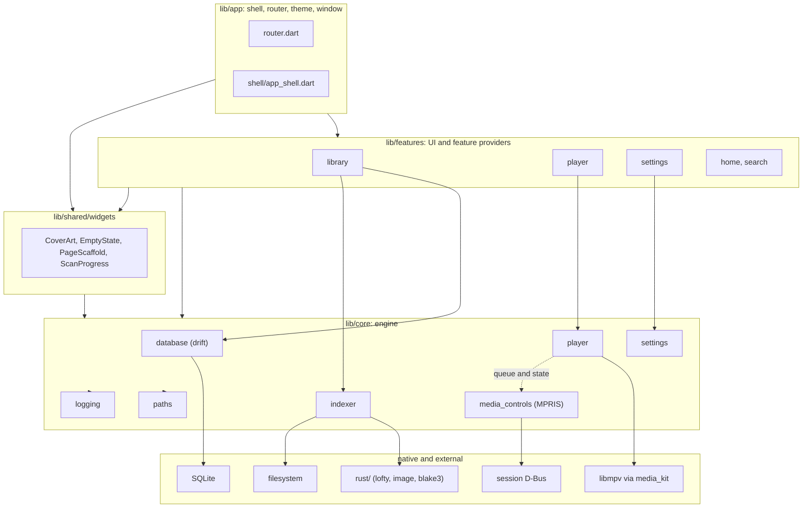
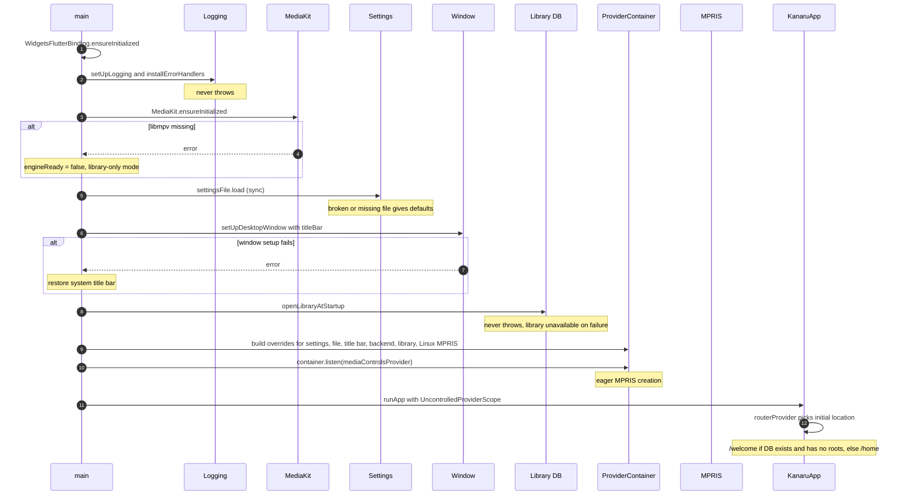
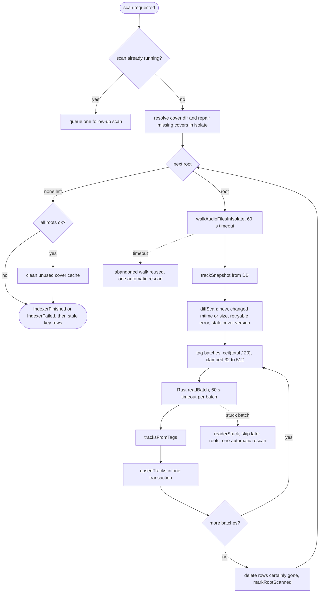
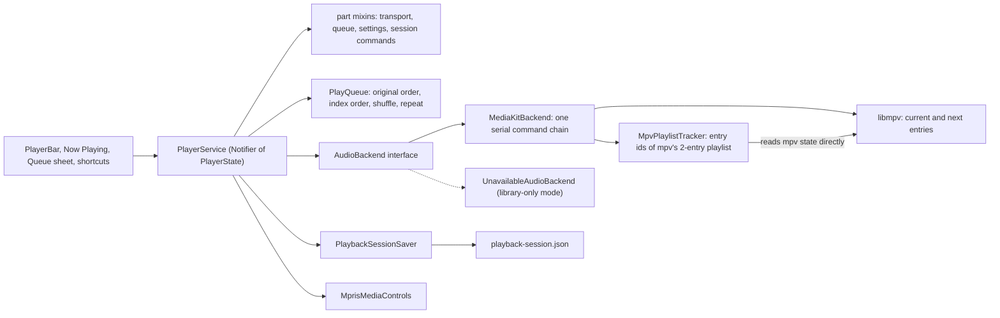
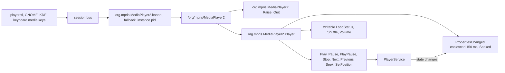
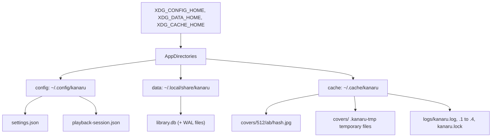
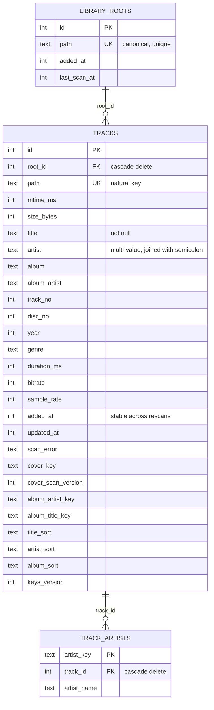
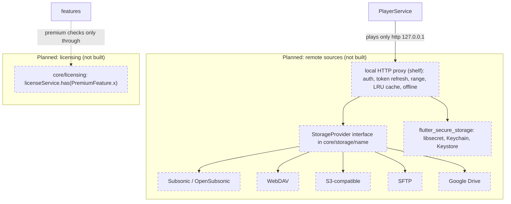

# System architecture

How Kanaru is put together at runtime: layers, startup, the library scan, playback, system media controls, storage, and the database schema. Items marked **Planned** are not in the code yet.

Related: [codebase-summary.md](./codebase-summary.md) (where things live), [code-standards.md](./code-standards.md) (rules), [project-overview-pdr.md](./project-overview-pdr.md) (scope).

## Contents

1. [Layers](#1-layers)
2. [Startup sequence](#2-startup-sequence)
3. [Library scan pipeline](#3-library-scan-pipeline)
4. [Playback](#4-playback)
5. [System media controls (MPRIS)](#5-system-media-controls-mpris)
6. [Storage locations](#6-storage-locations)
7. [Library database schema](#7-library-database-schema)
8. [Planned: remote sources and licensing](#8-planned-remote-sources-and-licensing)

---

## 1. Layers

Rules: `app → features → core`; `shared` may use `core`; `core` imports nothing above it. Details in [code-standards.md](./code-standards.md#layering).

Notes:

- `shared/widgets/scan_progress.dart` imports `core/indexer`, which is allowed (downward).
- `shared/library_route_keys.dart` duplicates two route literals because `shared/` and features cannot import `app/`. A test keeps them in step.
- `app/shell` injects the Now Playing title bar, so features do not reach into the shell.

---

## 2. Startup sequence

From [lib/main.dart](../lib/main.dart). Each step either succeeds or degrades; none of them stop the window from appearing.

After `runApp`, `PlayerService.build()` restores the saved queue synchronously and paused (see [section 4](#4-playback)). The library starts with its keys phase in `unknown`, then `updating` or `ready` (see [section 7](#7-library-database-schema)).

---

## 3. Library scan pipeline

Entry points: rescan button, Settings, onboarding, adding a folder. There is **no** startup scan, no file watcher and no root removal yet (features IDX-06, IDX-04 and root removal are open). One scan runs at a time; a request during a scan queues one follow-up.

Rules that shape the pipeline:

| Rule | Where |
|---|---|
| Delete only when certainly gone. Unstattable, unreadable, empty (unmounted) or missing roots keep their rows. | `indexer/scan_diff.dart` |
| Walk skips symlinked directories, dot-folders, `lost+found`, `@eaDir`, `$RECYCLE.BIN`, FIFOs, sockets and devices. Non-UTF-8 names are counted and skipped, rows kept. | `indexer/walk_audio_files.dart` |
| Permanent tag errors are not retried until the file changes or `tagReaderVersion` changes. Transient I/O errors are retried every scan. | `indexer/tracks_from_tags.dart`, `rust/src/tag_reader.rs` |
| Automatic rescans do not chain. | `indexer/library_indexer.dart` |
| Rust reads a batch in parallel on the `kanaru-tags-N` pool and never fails the batch as a whole. | `rust/src/tag_batch.rs` |

State is a sealed class: `Idle`, `Scanning`, `Finished`, `Failed` (`indexer/indexer_state.dart`). The UI shows progress through `ScanProgress`.

---

## 4. Playback

The Dart `PlayQueue` is the source of truth. The engine holds at most two entries: the current one and the next one, so gapless transitions do not need the whole queue in mpv.

Behavior:

- **Commands** (`openTracks`, `jump`, `next`, `previous`, `playPause`, `seek`, `setVolume`, `setShuffle`, `cycleRepeat`, `moveTrack`, `removeTrack`, `clearQueue`, and others) go through `PlayerService`. Errors surface as a stream; `seeked` is also a stream.
- **Queue** is immutable: the original list never changes; order is a list of indexes. Shuffle is Fisher–Yates with the current track first; un-shuffling restores `unshuffledOrder`. Stable keys make duplicate files safe.
- **Repeat**: `off`, `all`, `one`. `one` maps to mpv `PlaylistMode.single`; a loop is detected from position ticks and seeks to 0.
- **Failures**: a track that never reports a duration counts as failed. When every queued track fails in a row, the queue stops.
- **mpv settings**: `gapless-audio=weak`, `cache-on-disk=no` (`media_kit_backend.dart`). Volume is 0 to 100.
- **Session** (`playback-session.json`, next to `settings.json`): restores queue, position and volume, always paused. Writes happen right away on track change, pause, stop and seek; 500 ms debounce for queue, shuffle, repeat and volume; every 10 s while playing. Tracks are stored by source URI, never by proxy URL. Invalid files move to `*.invalid`; a newer format version is read-only. Saving is frozen after restore until a track loads or the user acts, so an unmounted drive cannot overwrite the session.
- **Not built**: ReplayGain (PLAY-07), crossfade, volume above 100%, speed and pitch, output device selection, sleep timer, equalizer.

---

## 5. System media controls (MPRIS)

Kanaru implements MPRIS 2.2 itself on `package:dbus` (no plugin). Linux only.

Details:

- Method calls reply immediately; the work runs in the background. Each handler is wrapped (`_guard`) because `package:dbus` does not catch handler errors.
- `CanQuit` is false. `CanRaise` is true; `Raise` calls `show` and `restore` on the window. On Wayland compositors that require xdg-activation (verified on niri) this does not bring the window forward (SYS-15).
- `OpenUri` is `NotSupported`. `HasTrackList` is false.
- Track IDs look like `/io/github/kanaru313/kanaru/track/<generation>_<originalIndex>`. `url` and `artUrl` are sent only for `file://` or absolute paths, so the local proxy token never leaks.
- `Position` is never signaled; clients poll it. `Seeked` is emitted on seeks.
- No reconnect logic: if the bus connection drops, controls stay down until restart.
- Desktop entry: `io.github.kanaru313.kanaru`.

---

## 6. Storage locations

Resolved in `lib/core/paths/app_directories.dart`. Relative or empty XDG variables are ignored; the resolver takes the environment as a map, so tests do not touch the real home.

| File | Format | Notes |
|---|---|---|
| `settings.json` | JSON v1 | Theme, language, title bar, library sort per screen, albums view. Unknown keys are kept. Secrets are never stored here (keyring planned). |
| `playback-session.json` | JSON v1 | Queue, position, volume, shuffle, repeat. Strict parse. |
| `library.db` | SQLite (drift) | Opened with WAL, `synchronous = NORMAL`, `foreign_keys = ON`, `busy_timeout = 5000`. |
| `covers/512/<ab>/<64-hex blake3>.jpg` | JPEG, 512 px longest side | Deduplicated by hash of the original image. Orphans are cleaned after a complete scan. |
| `logs/kanaru.log` | text | Owner of `kanaru.lock`. Rotated at start and at 10 MiB; 5 files kept. Other instances write `kanaru-<pid>.log`. |

Reset targets: `make reset-library`, `make reset-covers`, `make reset-all` (see [deployment-guide.md](./deployment-guide.md#reset-targets)).

---

## 7. Library database schema

drift, `schemaVersion = 3`, file `library.db`. Times are epoch milliseconds. Browse queries are raw SQL (`customSelect`) that read `tracks`; there are no `albums`, `artists` or `playlists` tables yet. Albums and artists are `GROUP BY` over the text keys.

Only the main columns are shown; see `lib/core/database/library_tables.dart` for the full list.

Indexes: `tracks_root(root_id)`, `tracks_title_sort(title_sort, id)`, `tracks_album_key(album_artist_key, album_title_key)`, `tracks_keys_version(keys_version)`, `track_artists_track(track_id)`.

Writes and reads:

| Topic | Behavior |
|---|---|
| Upsert | Batched `INSERT ... ON CONFLICT(path) DO UPDATE`; keeps `id`, `root_id`, `added_at`. Keys are computed by `trackKeysFor`. `track_artists` is replaced in the same transaction. |
| Deletes | Chunked, 500 ids per statement. |
| Whole-library lists | `throttledTracksQuery` replaces drift `.watch()`, because `.watch()` restarts on every write and starves during scans. Dirty flag, no overlapping loads, cooldown. |
| Songs paging | IDs come from `group_concat`; pages of 200; `songsByIds` in chunks of 200 keeps order; `songQueueFrom(trackId)` reads in one transaction. |
| Ordering | Songs: NULLs last in both directions, ties by `title_sort`, `id`. Albums and artists are sorted in Dart by code point, matching the database. |
| Text keys | Pure Dart (`text_keys.dart`, generated tables in `text_key_tables.dart`). `textKeysVersion = 1`. Stale rows are re-keyed in place when few (≤ 500), or in a background isolate. Conditional writes let a concurrent scan win. |
| Migrations | Step-by-step (`library_database.steps.dart`). v1 → v2 adds cover columns; v2 → v3 is schema-only and re-runnable (`library_migration_v3.dart`). Values are filled by the background key backfill. |

Planned schema work: full-text search (FTS5, SEARCH-01), playlists, play statistics, and collapsing the history to v1 before the first release (PKG-08). See [project-roadmap.md](./project-roadmap.md).

---

## 8. Planned: remote sources and licensing

**Planned: none of the components below exist in the code.** They are the target design from the README and [features.md](./features.md) (SRC-01, CACHE-01, PRIV-04). Do not write code against them until they land.

| Planned piece | Rule it must follow | Current state |
|---|---|---|
| `StorageProvider` per backend in `lib/core/storage/<name>/` | Every source implements the same interface: list, stat, ranged read, artwork | Not started. The `core/storage` folder does not exist. |
| Local HTTP proxy | The player never calls a remote service directly; it plays `http://127.0.0.1:<port>/track/<id>` | Not started. `shelf` is not in `pubspec.yaml`. |
| Credentials | Passwords and tokens only in the system keyring, never in the DB, logs or `settings.json` | Not started. `flutter_secure_storage` is not in `pubspec.yaml`. |
| Licensing | Premium checks only through `core/licensing`; features never parse licenses | Not started. Premium list is a proposal ([features.md section 20](./features.md)). |

Open points (not decided): whether remote tracks join the same `tracks` table with a source column, and how the proxy cache limit is configured. Track these in [project-roadmap.md](./project-roadmap.md) before building Phase 3.
