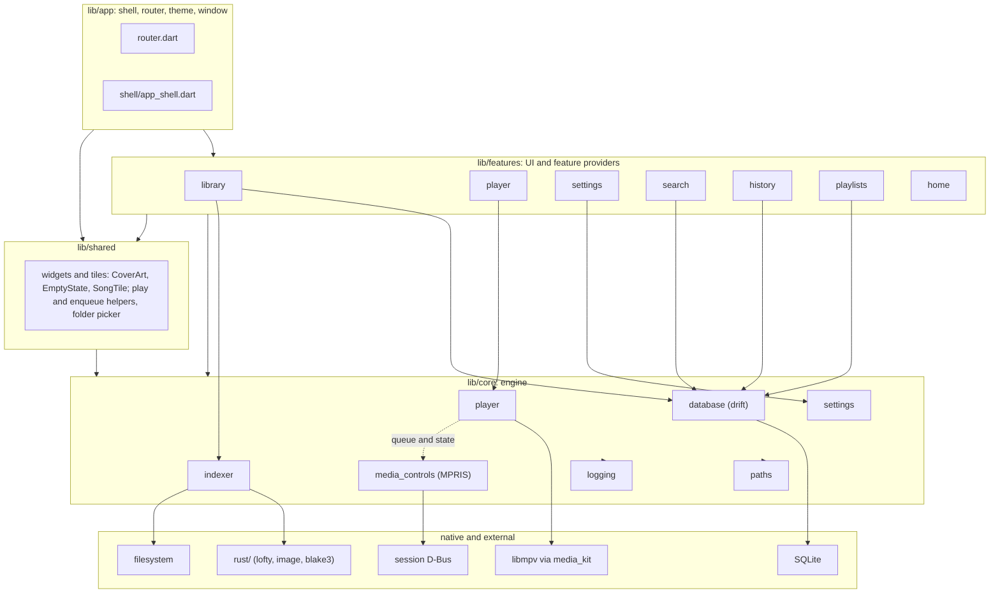
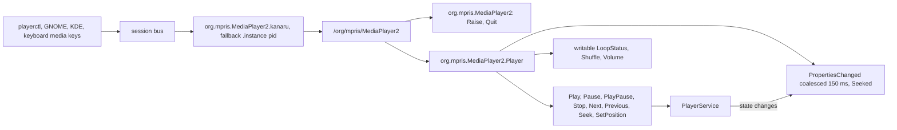
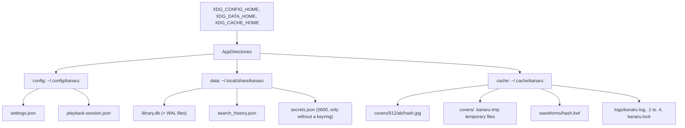
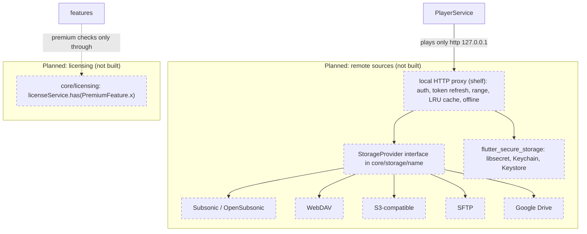

# System architecture

How Kanaru is put together at runtime: layers, startup, the library scan, playback, system media controls, storage, and the database schema. Items marked **Planned** are not in the code yet.

Related: [codebase-summary.md](./codebase-summary.md) (where things live), [code-standards.md](./code-standards.md) (rules), [project-overview-pdr.md](./project-overview-pdr.md) (scope).

## Contents

1. [Layers](#1-layers)
2. [Startup sequence](#2-startup-sequence)
3. [Library scan pipeline](./system-architecture-library.md)
4. [Playback](./system-architecture-playback.md), with [Lyrics](./system-architecture-lyrics.md) and [Lyrics plugins](./system-architecture-lyrics-plugins.md)
5. [System media controls (MPRIS)](#5-system-media-controls-mpris)
6. [Storage locations](#6-storage-locations)
7. [Library database schema](./system-architecture-database.md), with [User data](./system-architecture-user-data.md)
8. [Planned: remote sources and licensing](#8-planned-remote-sources-and-licensing)

---

## 1. Layers

Rules: `app → features → core`; `shared` may use `core`; `core` imports nothing above it. Details in [code-standards.md](./code-standards.md#layering).



Notes:

- `shared/widgets/scan_progress.dart` imports `core/indexer`, which is allowed (downward).
- `shared/library_route_keys.dart` duplicates four route literals (`/albums`, `/artists`, `/genres`, `/folders`) because `shared/` and features cannot import `app/`. A test keeps them in step.
- `app/shell` injects the Now Playing title bar, so features do not reach into the shell.
- The History and Favorites pages are owned by their features, so these features add pages without editing `app/`: `features/history/history_routes.dart` declares `historyPath` and `historyRoutes` (pages under `/history`) next to `HistoryScreen`; `features/playlists/favorites_routes.dart` declares `favoritesPath` and `favoritesRoutes` next to `FavoritesScreen`. The History page shows every listen by day and the songs played most in a date range (two tabs), with a page per song at `/history/track`; the Favorites page shows the Favorites playlist (`playlists.kind = 'favorites'`) with the playlist page body, or an empty state before the first like. Shell tests check only the location and the page widget type; page content is tested with the feature.

---

## 2. Startup sequence

From [lib/main.dart](../lib/main.dart). Each step either succeeds or degrades; none of them stop the window from appearing.

```mermaid
sequenceDiagram
    autonumber
    participant M as main
    participant L as Logging
    participant K as MediaKit
    participant S as Settings
    participant W as Window
    participant D as Library DB
    participant C as ProviderContainer
    participant X as MPRIS
    participant A as KanaruApp

    M->>M: WidgetsFlutterBinding.ensureInitialized
    M->>L: setUpLogging and installErrorHandlers
    Note over L: never throws
    M->>K: MediaKit.ensureInitialized
    alt libmpv missing
        K-->>M: error
        Note over M: engineReady = false, library-only mode
    end
    M->>S: settingsFile.load (sync)
    Note over S: broken or missing file gives defaults
    M->>W: setUpDesktopWindow with titleBar
    alt window setup fails
        W-->>M: error
        Note over M: restore system title bar
    end
    M->>D: openLibraryAtStartup
    Note over D: never throws, library unavailable on failure
    M->>C: build overrides for settings, file, title bar, backend, library, Linux MPRIS
    M->>C: container.listen(mediaControlsProvider)
    Note over C: eager MPRIS creation
    M->>A: runApp with UncontrolledProviderScope
    A->>A: routerProvider picks initial location
    Note over A: /welcome if DB exists, no roots and not yet onboarded, else /home
    A->>C: after the first frame, runLibraryStartupTasks
    Note over C: marks a library with roots as onboarded, quiet scan if enabled
    A->>A: after the first frame, the shell checks every root with isDirectory
    Note over A: once per launch; a snackbar with a Settings action names missing folders
    A->>C: container.listen(folderWatcherProvider)
    Note over C: folder watcher follows the Watch folders setting, kept for the session
    A->>C: then startOpenFiles (Linux)
    Note over C: handler for openFiles first, then takePendingFiles; files the app was launched with play now
```

**Opening files from the command line.** The Linux runner (`linux/runner/my_application.cc`, the open-files part in `linux/runner/open_files.{h,cc}`) has `G_APPLICATION_HANDLES_OPEN`. Its `local_command_line` turns every argument that does not start with `-` (or every argument after `--`) into a `GFile` (`g_file_new_for_commandline_arg`: a relative path is resolved against the folder of the process that was started, a `file://` URI is percent-decoded; ignored `-` arguments are counted in the log) and calls `g_application_open`, or `g_application_activate` when there are none. In a second launch GApplication sends the files to the running instance over D-Bus and the process exits 0 without an engine; the first launch handles them itself. The `open` handler creates the window if needed, keeps only native files whose path is valid UTF-8 (at most 1000; skipped ones are only counted in the log, never named), then sends the paths on the method channel `io.github.kanaru313.kanaru/open_files`, or holds them until Dart calls `takePendingFiles`. Before Dart is ready the newest request replaces the one waiting. A new window (new engine) drops the old channel and starts again from "not ready". Dart sets its `openFiles` handler before that call, and the runner starts sending directly when it answers it, so no file is lost or doubled. `OpenFilesService` checks every path with `localAudioPath`, takes at most 1000, reads tags in batches (5 s timeout per batch; a timed-out or failed batch plays under file names, and no new read starts until the stuck call returns), and calls `PlayerService.openTracks`. The newest request that has at least one playable path replaces one still reading; a request where nothing passes changes nothing. Nothing plays until every tag batch of the request is read, so a slow disk or a busy native pool (the startup scan shares it; the opened files are queued first) delays playback by up to the 5 s timeout of a batch. Playing at once and adding tags later needs a player API (follow-up). Debug builds (`NON_UNIQUE`) take the same path for their own command line. The runner still passes the arguments to the Dart entrypoint (`dart_entrypoint_arguments`), but `main()` ignores them.

After `runApp`, `PlayerService.build()` restores the saved queue synchronously and paused (see [section 4](system-architecture-playback.md#4-playback)). The library starts with its keys phase in `unknown`, then `updating` or `ready` (see [section 7](system-architecture-database.md#7-library-database-schema)).

---

## 5. System media controls (MPRIS)

Kanaru implements MPRIS 2.2 itself on `package:dbus` (no plugin). Linux only.



Details:

- Method calls reply immediately; the work runs in the background. Each handler is wrapped (`_guard`) because `package:dbus` does not catch handler errors.
- `CanQuit` is false. `CanRaise` is true; `Raise` calls `show` and `restore` on the window. On Wayland compositors that require xdg-activation (verified on niri) this does not bring the window forward (SYS-15).
- `OpenUri` is `NotSupported`. `HasTrackList` is false.
- Track IDs look like `/io/github/kanaru313/kanaru/track/<generation>_<originalIndex>`. `url` and `artUrl` are sent only for `file://` or absolute paths, so the local proxy token never leaks.
- `Position` is never signaled; clients poll it. `Seeked` is emitted on seeks.
- No reconnect logic: if the bus connection drops, controls stay down until restart.
- Desktop entry: `io.github.kanaru313.kanaru`.

---

## 6. Storage locations

Resolved in `lib/core/paths/app_directories.dart`. `resolveCoverCacheDirectory` and `resolveWaveformCacheDirectory` give the `covers/512` and `waveforms` folders of the cache. Relative or empty XDG variables are ignored; the resolver takes the environment as a map, so tests do not touch the real home.



| File | Format | Notes |
|---|---|---|
| `settings.json` | JSON v1 | Theme, language, title bar, library sort per screen, albums and playlists views (`albumsView`, `playlistsView`: grid or list, missing or unknown is grid), `rescanOnStartup` (default on), `libraryOnboarded` (first-run picker done), and the option groups `libraryScan`, `playback`, `display`. `display` holds, among others, `waveformSeekBar` (default true: the waveform seek bar in the wide Now Playing modes; false shows the flat track). `playback` holds ReplayGain (`replayGainMode` off/track/album/auto, default off; `replayGainPreampDb` −15..15, default 0; `replayGainPreventClipping`, default true, which is mpv `replaygain-clip=no`) and the output device (`audioDeviceName`/`audioDeviceDescription`, absent = mpv `auto`); `libraryScan` holds `watchFolders` (default off) and `skipHiddenFolders` (default on). Defaults are today's behavior; the scan reads `libraryScan` (`respectNomedia`, `skipHiddenFolders`, `minFileSizeKb`, `minDurationSeconds`, `watchFolders`), the player does not read `playback` yet. A missing or wrong-typed key gives its default, a number outside its range is clamped. Unknown keys are kept. Secrets are never stored here: the DeepL key lives in the system keyring, or in `secrets.json` when there is none (`core/secrets/`). `lyricsTranslation` holds `show` (default off), `service` (`google`/`deepl`), `targetLanguage` (absent = follow the app language), `display` (`underLine`/`replace`) and `noticeAcknowledged` (services the user accepted the network notice for; `show` reads as off when the chosen service is not listed). `onlineLyrics` holds `autoFetch` (default off), `manualConsent` and `autoConsent` (default off): one consent for all online lyrics sources. A file from an older build with the per-source list `noticeAcknowledged` is migrated when neither flag is stored: a string with `@` grants `manualConsent`, one ending `:auto` grants `autoConsent` and `manualConsent`, so a user who accepted LRCLIB sees no new notice; the list is dropped on the next save and never written. A legacy `writeLrc` key is dropped too; unknown keys are kept. `autoFetch` reads as off unless `autoConsent` is on, and `SettingsNotifier.setOnlineLyrics` cannot change the flags or turn auto on without the consent; `SettingsNotifier.withdrawOnlineLyricsConsent()` is the only way to clear them (both flags and `autoFetch` in one write). |
| `secrets.json` | JSON object `{"deepl_api_key": "..."}` | Data directory, mode `0600`. Used only when the session has no Secret Service or no session bus (`lib/core/secrets/`); a locked keyring, a Secret Service without a default keyring, or a keyring that does not answer never falls back to it; otherwise the DeepL key lives in the system keyring. Written through a temp file (`secrets.json.<pid>.tmp`) that is restricted before it holds data. Never attach it to bug reports. |
| `playback-session.json` | JSON v1 | Queue, position, volume, shuffle, repeat (`reshuffle` marks repeat all shuffled). Strict parse. |
| `search_history.json` | JSON v1 | Data dir. The last 20 search queries (newest first, repeats ignoring case moved up) and the fields the search looks at. Written atomically, one save after another; read async at startup. A broken file is renamed `.invalid` and the defaults are used; a newer version is read but not overwritten. Queries are never logged. Two instances: last write wins. |
| `library.db` | SQLite (drift) | Opened with WAL, `synchronous = NORMAL`, `foreign_keys = ON`, `busy_timeout = 5000`. |
| `covers/512/<ab>/<64-hex blake3>.jpg` | JPEG, 512 px longest side | Deduplicated by hash of the original image. Orphans are cleaned after a complete scan. |
| `waveforms/<64-hex blake3>.kwf` | binary, up to about 1 KB | Waveform levels of one audio file version (key: path, size, mtime, ctime, inode); see [Waveforms](system-architecture-playback.md#waveforms). At most 20 000 entries (about 80 MB on ext4 with 4 KiB blocks); entries not used for 90 days expire (a hit refreshes the entry's mtime). Cache dir, deletable at any time. |
| `logs/kanaru.log` | text | Owner of `kanaru.lock`. Rotated at start and at 10 MiB; 5 files kept. Other instances write `kanaru-<pid>.log`. |

The trash is not under `kanaru`: a replaced `.lrc` goes to the freedesktop trash GLib picks, `$XDG_DATA_HOME/Trash` (default `~/.local/share/Trash`) for a song on the home disk and `<mount>/.Trash-<uid>` on another disk, outside every library folder. A disk without a trash (a system mount, a mount marked no-trash) makes the replace fail with nothing changed.

Reset targets: `make reset-library`, `make reset-covers`, `make reset-all` (see [deployment-guide.md](./deployment-guide.md#reset-targets)).

---

## 8. Planned: remote sources and licensing

**Planned: none of the components below exist in the code.** They are the target design from the README and [features.md](./features.md) (SRC-01, CACHE-01, PRIV-04). Do not write code against them until they land.



| Planned piece | Rule it must follow | Current state |
|---|---|---|
| `StorageProvider` per backend in `lib/core/storage/<name>/` | Every source implements the same interface: list, stat, ranged read, artwork | Not started. The `core/storage` folder does not exist. |
| Local HTTP proxy | The player never calls a remote service directly; it plays `http://127.0.0.1:<port>/track/<id>` | Not started. `shelf` is not in `pubspec.yaml`. |
| Credentials | Passwords and tokens only in the system keyring, never in the DB, logs or `settings.json`. Without a Secret Service: a `0600` `secrets.json` in the data directory, with a visible warning | Store built for the DeepL key in `lib/core/secrets/` (`flutter_secure_storage`; a D-Bus probe runs before each plugin call). It exposes `usingFallback` and `modeWasFixed`; the visible warning arrives with the settings rows, not built yet. Remote-source credentials will reuse the store. |
| Licensing | Premium checks only through `core/licensing`; features never parse licenses | Not started. Premium list is a proposal ([features.md section 20](./features.md)). |

Open points (not decided): whether remote tracks join the same `tracks` table with a source column, and how the proxy cache limit is configured. Track these in [project-roadmap.md](./project-roadmap.md) before building Phase 3.

## See also

- [Lyrics plugin API](./lyrics-plugin-api.md) - the script contract for lyrics plugins
- [Project roadmap](./project-roadmap.md) - open and planned work
- [Codebase summary](./codebase-summary.md) - where the code lives
